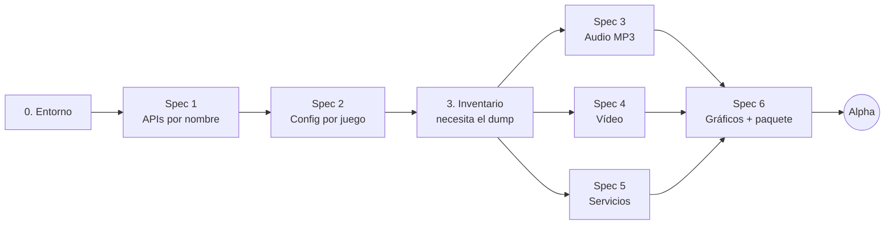

# gow3_pc — Roadmap hasta la versión Alpha

Port de **God of War III Remastered** (PS4) a Windows, construido a partir de
[bbport / bloodborne_pc](https://github.com/Supermedo/bloodborne_pc).

| | |
|---|---|
| Repositorio | [FelipePrado0/gow3_pc](https://github.com/FelipePrado0/gow3_pc) (fork de `Supermedo/bloodborne_pc`, rama `windows`) |
| Juego objetivo | God of War III Remastered, **CUSA01623**, versión **01.02** |
| Plataforma | Windows 10/11 de 64 bits, Vulkan 1.3 |
| Máquina de pruebas | AMD Radeon RX 6700 XT, Ryzen 5 5600X, 32 GB |
| Última actualización | 2026-10-09 (optimizaciones de GPU y lote de calidad de vida) |

---

## Índice

1. [Cómo funciona el proyecto (versión simple)](#1-cómo-funciona-el-proyecto-versión-simple)
2. [Definición de la Alpha](#2-definición-de-la-alpha)
3. [Visión general de las etapas](#3-visión-general-de-las-etapas)
4. [Etapas en detalle](#4-etapas-en-detalle)
5. [Riesgos](#5-riesgos)
6. [Pendientes del usuario](#6-pendientes-del-usuario)
7. [Después de la Alpha](#7-después-de-la-alpha)
8. [Glosario](#8-glosario)
9. [Referencias](#9-referencias)

---

## 1. Cómo funciona el proyecto (versión simple)

**No es descompilación ni emulación completa.** El ejecutable original del juego (`eboot.bin`) se ejecuta
sin modificaciones, directamente en el procesador del PC. Esto es posible porque la PS4 usa un procesador
de la misma familia que el del PC (x86-64, AMD).

Lo que hace el proyecto es **imitar el sistema de la PS4** alrededor del juego:

| Analogía web | En el proyecto | Dónde está |
|---|---|---|
| App compilada sin código fuente | Ejecutable del juego | `CUSA01623/eboot.bin` (dump del usuario) |
| Script de build/deploy | Preparación: lee el ejecutable y genera una imagen lista para cargar | `scripts/prepare.py`, `scripts/link_modules.py` |
| Servidor que levanta la app | Loader: carga la imagen en memoria e inicia el juego | `src/probe.c` |
| Implementación falsa de las APIs del servidor | Runtime: reimplementa las APIs de la PS4 usando Windows | `src/runtime_*.c` |
| Adaptador de base de datos | Traductor de gráficos: comandos de la GPU de la PS4 → Vulkan | `gpu/` (núcleo de shadPS4) |
| Error 404 con el nombre de la ruta | Cuando el juego llama a una API que no existe, el programa se detiene e imprime `STOP: first unsupported PS4 import: <nombre>` | `src/probe.c` |

El trabajo del port es, básicamente: **implementar cada API que usa God of War III y que el
port base no implementaba, y corregir los defectos gráficos.**

---

## 2. Definición de la Alpha

### Objetivo

God of War III Remastered abre con el loader nativo, reproduce la cutscene de apertura y el prólogo
(batalla contra Poseidón) hasta el primer save, con sonido, vídeo y control.

### Criterios de aceptación

- [ ] El juego llega al menú principal e inicia un New Game.
- [ ] El prólogo se ejecuta hasta el primer save sin colgarse ni cerrarse.
- [ ] La cutscene de apertura se reproduce con vídeo y sonido.
- [ ] Música, efectos y voces funcionan.
- [ ] El mando (vía SDL) y el teclado funcionan.
- [ ] El save se graba y se carga tras reiniciar el juego.
- [ ] Media de 60 FPS o más a 1080p en la RX 6700 XT.
- [ ] Sin texturas corruptas ni pantalla blanca en el recorrido.
- [ ] El log (`user/last_run.log`) no contiene `STOP:` ni `Fault:` en el recorrido.

### Fuera de la Alpha

- Upscaling temporal (FSR 3/4, DLSS) y motion vectors.
- Launcher completo con todas las opciones.
- Otras regiones (CUSA01715 etc.) y otras versiones del juego.
- Linux y Steam Deck.

---

## 3. Visión general de las etapas

| # | Etapa | Tipo | ¿Necesita el juego? | Depende de | Estado |
|---|---|---|---|---|---|
| 0 | Preparar el entorno | Setup | No | — | ✅ Concluida |
| 1 | Reconocer APIs por nombre | **Spec 1** | No | 0 | ✅ Concluida |
| 2 | Configuración por juego + patches | **Spec 2** | No | 1 | ✅ Concluida |
| 3 | Inventario de APIs faltantes | Diagnóstico | **Sí** | 1, 2 | ✅ Concluida |
| 4 | Audio MP3 | **Spec 3** | Sí | 3 | ✅ Concluida |
| 5 | Vídeo de las cutscenes | **Spec 4** | Sí | 3 | ✅ Concluida |
| 6 | Servicios del sistema que faltan | **Spec 5** | Sí | 3 | ✅ Concluida |
| 7 | Gráficos correctos + paquete | **Spec 6** | Sí | 4, 5, 6 | 🟨 En curso |

**Total: 6 specs** (pueden pasar a 7–8 según el inventario de la etapa 3).

### Lo que ya se hizo

| # | Entregado | Commit |
|---|---|---|
| 0 | MSYS2 CLANG64 instalado; `bash build.sh` genera `out/gow3-probe.exe` en Windows; rama `gow3` creada. Línea base de los tests de Python: 7 fallos que ya existían (tests solo de Linux). | — |
| 1 | Imports grabados como `NID#biblioteca` (iguales en cualquier juego), con libScePosix tratada como libkernel. La nueva opción `--check-imports` lista lo que falta sin ejecutar el juego. | `c4617d2` |
| 2 | Perfil por juego mediante el `TITLE_ID`: GoW3 usa `patches/God_of_War_III_Remastered.xml` solo en la v01.02; DMEM y VBlank leídos de las notas de los patches; el patch de resolución sustituye al Texture Fix; menú Insert con el nombre del juego. | `4589fb9` |
| 3 | Dump CUSA01623 v01.02 verificado. `--check-imports`: 387 imports, 45 faltantes (35 llamados por el juego, 10 solo por libc/Fios2). Lista en la sección de la etapa 3. | `ea89783` |
| 4 (Spec 3) | MP3 en libSceAjm mediante FFmpeg (`src/runtime_mp3.c`): lectura de la cabecera y de los metadatos gapless (LAME/Xing, VBRI, FGH), `sceAjmDecMp3ParseFrame`, salida S16/S32/float. Test `mp3-test`: la salida coincide muestra a muestra con la decodificación del propio FFmpeg. | `6f0a7a6` |
| 5 (Spec 4) | `sceVideodec` (H.264 a NV12) mediante FFmpeg (`src/runtime_videodec.c`): QueryResourceInfo, CreateDecoder, Decode, Flush, Reset, DeleteDecoder. Una imagen mayor que el buffer del juego devuelve error en lugar de desbordar memoria. Test `videodec-test` con 6 fotogramas, incluidos B-frames. | `4a96c28` |
| 6 (Spec 5) | Las 37 APIs restantes: diálogos de mensaje y de save (la barra de progreso queda abierta hasta que el juego la cierra), PlayGo (todo instalado), trofeos (nada desbloqueado), barra de luz del mando, área segura de la pantalla, argumentos del proceso, `mmap`/`msync` anónimos, atributos de condición. La API desconocida era `sceKernelStopUnloadModule` (confirmado por el hash del nombre); responde "módulo inexistente". Test `services-test`. | `68409d4` |
| 7 (Spec 6) | GPU: las imágenes copiadas de vuelta desde la GPU pasan a esperar a la GPU una vez por envío, no una vez por imagen (el gameplay subió de 2 a 52–60 FPS). Aviso `IT_SET_PREDICATION` registrado una sola vez. El teclado funciona junto con el mando. | `08eadbc` |
| 7 (Spec 6a) | Lista de saves en pantalla (overlay): el juego recibe la carpeta elegida al guardar y cargar; "New save" y cancelar también funcionan. Test en `services-test`. | `79d2f58` |
| 7 (Patches) | Los patches de shadPS4 eran de otra compilación del eboot v01.02. Direcciones recalculadas y verificadas byte a byte en el dump (resolución +0x10 y -0x120, datos en el mismo lugar). El patch solo se aplica si el sha256 del `eboot.bin` es el del dump. 1440p probado a 60 FPS. | `e749951` |
| 7 (Patches) | 120 FPS portado: límite de FPS en `0x75dbe4` y lectura de los FPS en el cálculo de energía del golpe en `0x48ff1a` (constante 60,0). Se acabó el juego acelerado. | `d307830` |
| 7 (Spec 6b) | Launcher de God of War III: página Patches del juego (resolución única y patches del XML), nombre, banner e icono del juego, páginas del juego original del port base ocultas, icono en la ventana del juego, actualización automática desactivada, textos sin guiones largos. | `18a0d11`, `026147e` |
| 7 (Limpieza) | Código solo de God of War III: se eliminaron los patches, el hack de sonido, el modo de FPS, los efectos, los cheats y las páginas del launcher del juego original, además del launcher GTK de Linux. El prefijo antiguo pasó a ser `gow3` (archivos, binarios `gow3-*`, variables `GOW3_*`, `gow3.ini`, `God of War III.exe`); icono nuevo. Upscalers conservados en el código, desactivados, para calibrarlos después. Mods conservados con layout genérico (`dvdroot_ps4`). | — |

`--check-imports` tras la spec 5: **0 faltantes** (eran 45).

Primera ejecución real (60 s, 2026-10-08): el juego arranca sin `STOP:` ni `Fault:`; abre los puertos de audio, inicia el Ajm, crea el save, carga los WAD de las fases y envía comandos a la GPU. Lo que aparece en pantalla aún no se ha verificado (inicio de la spec 6).

| 7 (GPU) | Compilación asíncrona de shaders (`GOW3_ASYNC_SHADERS=1`), con workers, cola urgente y cachés por worker. | `adde71e`, `cd9c70f` |
| 7 (GPU) | Correcciones portadas del fork eltutz: brillo quemado (aliasing de imágenes) y sombras rotas (depth/stencil sin uso). Blend MIN/MAX igual que en la PS4. | `036d5d7`, `4676e1c`, `9c88add` |
| 7 (GPU) | Diagnóstico de esperas de la GPU (`GOW3_PERF_DIAG=1`) y readback diferido (`GOW3_DEFERRED_READBACK=1`): esperas por fotograma de 8 a 1 y FPS medios de 38,0 a 40,2 en la escena de referencia. | `d169080`, `7c1db31` |
| Extras | Multiplicador de orbes rojas y cheats con interruptor en el menú Insert. | `14b5c6d`, `c7d58c3` |

**Lote del 2026-10-09**

| Elemento | Qué hace | Estado |
|---|---|---|
| Copia de seguridad de saves | Copia de `user/savedata` antes de cada apertura, se conservan 10, restauración desde el launcher | Validado |
| Mods | Aviso de archivos en conflicto y presets de mods en el launcher | Tests automáticos ok |
| Controles | Remapeo de teclado y mando en la página Controls, nombres PlayStation o Xbox | Tests automáticos ok |
| Warmup paralelo | Loading de la caché de 300 s a unos 70 s, mismas pipelines (checkbox, activada por defecto) | Validado en el juego |
| Barra de vida del enemigo | Hook en la rutina de daño; barra verde centrada con la vida en números, opción en el menú Insert | Validado en el juego |
| Origen de los readbacks | Informe por consumidor de las esperas restantes (checkbox de diagnóstico) | Medido: el 100 % de la espera es una lectura de la CPU por fotograma, 11,6 ms |
| Lectura sin esperar a la GPU | El juego usa la copia del fotograma anterior (exposición 1x1) y escribe junto a ella sin esperar; checkbox activada por defecto | Validado: de 40,9 a 66,5 FPS en la escena de referencia |
| Protección de páginas | Test permanente de la regresión del permiso no válido | Test ok |
| FSR 1, nitidez y cola de fotogramas | Opciones en vivo en el menú Insert, avisos con los tamaños de la imagen y de la ventana | Validado en el juego |
| Mapa del fotograma | Profundidad, cámara, color de la escena y HUD localizados para el upscaler y frame generation (ver docs/upscaler.md) | Concluido |

**Criterios de la alpha (situación al 2026-10-08)**

| Criterio | Situación |
|---|---|
| Menú y New Game | ✅ |
| Cutscene de apertura con vídeo y sonido | ✅ |
| Música, efectos y voces | ✅ |
| Mando y teclado | ✅ |
| El save se graba y se carga tras reiniciar | 🟨 lista de saves lista, falta la prueba del usuario |
| 60 FPS a 1080p en la RX 6700 XT | ✅ (52 a 60; caídas solo en la primera compilación de shaders) |
| Sin texturas corruptas ni pantalla blanca | 🟨 Texture Fix y lectura lineal activados; falta recorrer todo el prólogo |
| Log sin `STOP:` ni `Fault:` en el recorrido | ✅ en las pruebas realizadas |
| Paquete zip que funcione sin MSYS2 | ⬜ pendiente |

**Pendientes conocidos**

- **Skip Intro** no se portó: su código no coincide con este eboot y quedó fuera del XML.
- **120 FPS:** con el patch, el juego funciona a velocidad normal incluso por debajo de 120 FPS (confirmado jugando el 2026-10-09, a unos 40 FPS). La afirmación anterior de cámara lenta por debajo de 120 era errónea.
- **Inicialización:** con la caché llena (5226 pipelines) el loading serial tarda de 300 a 400 s. El warmup paralelo tarda unos 70 s y viene activado por defecto en el launcher.
- **Rendimiento real:** la escena de referencia funciona a unos 66 FPS (58 a 70) con el patch de 120 FPS, sin espera de readback.
- **Saves de prueba:** existen 10 saves `SD-2610080631xx` creados antes de la lista de saves; pueden borrarse.
- **Predicación de la GPU** (`IT_SET_PREDICATION`) sigue sin implementarse, como en shadPS4.
- **Linux:** el `build.sh` de Linux recibió los tests nuevos y FFmpeg en el runtime, pero no se compiló.
- **Menú Insert:** los textos aún están en ruso e inglés.
- **Configuraciones antiguas:** las del port base no se migran; los nombres nuevos son `gow3.ini` y `%APPDATA%\gow3-launcher`.
- **Upscalers temporales:** FSR 3/4, DLSS, TAA y vectores de movimiento siguen en el código, desactivados; falta mapear el fotograma de God of War III (color de la escena, profundidad, constantes de la cámara).

- Los tests en C (`test_runtime.c`, `test_content.c`, `test_sema.c`) no compilan en Windows mediante `build.sh`. Las llaves se convirtieron, pero esos tests aún no se han ejecutado.
- Dejar `--check-imports` en cero no garantiza que el juego abra: los cuelgues de ejecución y los defectos gráficos entran en la spec 6.

Leyenda de estado: ⬜ Pendiente · 🟨 En curso · ✅ Concluida · ⛔ Bloqueada

### Flujo de cada spec

1. Spec escrita (objetivo, contrato, casos de error, archivos, criterios de aceptación).
2. **Aprobación del usuario** (único punto de parada obligatorio).
3. Tests escritos antes del código, cuando la lógica no es trivial.
4. Implementación.
5. Validación: tests automáticos y ejecución real del juego.
6. Commit y actualización del estado en esta página.

---

## 4. Etapas en detalle

### Etapa 0 — Preparar el entorno

**Qué es:** instalar el compilador y confirmar que el proyecto, todavía sin cambios, compila.

**Pasos**

1. Instalar MSYS2: `winget install MSYS2.MSYS2`.
2. En el shell **MSYS2 CLANG64**, instalar los paquetes listados en
   [packaging/windows/README.md](../../packaging/windows/README.md).
3. `git submodule update --init --recursive` (ya hecho en el clon).
4. `bash build.sh` y confirmar que existen `out/gow3-probe.exe` y `out/gow3-gpu-capabilities.exe`.
5. `python -m unittest discover -s tests` y anotar la línea base (qué pasa y qué falla ya).
6. Crear la rama `gow3`.

**Listo cuando:** el build termina sin errores y la línea base de los tests está registrada.

---

### Spec 1 — Reconocer APIs por nombre

**Problema:** el runtime identifica cada API de la PS4 por un nombre que incluye códigos internos del
dump del juego original del port base (ej.: `"bzQExy189ZI#q#q"`). En God of War III esos códigos son otros y
no se encontraría ninguna API.

**Solución:** cambiar a una clave canónica `NID#nombreDeLaBiblioteca` (ej.:
`bzQExy189ZI#libc`), que es igual en cualquier juego. Añadir un comando que liste las APIs
faltantes sin ejecutar el juego.

**Archivos afectados**

- `scripts/link_modules.py` — generar nombres canónicos en la imagen.
- `src/import_names.inc` — reescribir las ~750 entradas con la clave canónica.
- `src/runtime.c`, `src/runtime_memory.c` — comparaciones directas con los nombres antiguos.
- `src/probe.c` — nueva opción `--check-imports`.
- `tests/` — nuevo test de la clave canónica.

**Requisitos**

- El sistema debe resolver siempre una API por la clave canónica, sin depender de los códigos locales
  del dump.
- Cuando se use `--check-imports`, el sistema debe listar todas las APIs sin implementación y
  salir con un código distinto de 0 si falta alguna.
- Cuando el juego llame a una API sin implementación, el sistema debe detenerse con `STOP:` y el nombre.
  Nunca debe fingir éxito.

**Criterios de aceptación**

- [ ] Un test demuestra que la misma API se resuelve igual con códigos locales distintos.
- [ ] Los tests existentes se mantienen en la misma línea base de la etapa 0.
- [ ] `gow3-probe.exe out/boot-linked.bin --check-imports` imprime la lista y el código de salida.

---

### Spec 2 — Configuración por juego + patches

**Problema:** el nombre, el ID, la versión y los patches del juego original del port base estaban fijos en el código.

**Solución:** leer el título y el ID del `param.sfo` del juego, aceptar `CUSA01623`, aplicar los patches
según el juego y la versión.

**Archivos afectados**

- `run.py` — carpeta predeterminada del juego y mensajes.
- `scripts/patches.py` — validación de patches por ID y versión del juego.
- `src/probe.c`, `gpu/shim/gow3gpu.cpp`, `gpu/shim/gow3_overlay.cpp` — título de la ventana y del menú.
- `patches/God_of_War_III_Remastered.xml` — nuevo, con los patches de resolución (720p, 1440p,
  4K) y 120 FPS de la comunidad ([ps4_cheats#145](https://github.com/shadps4-emu/ps4_cheats/pull/145)).
- `tests/test_patches.py` — casos nuevos.

**Requisitos**

- Cuando el juego no sea CUSA01623 v01.02, el sistema debe rechazar los patches de God of War III
  y registrar el motivo en el log.
- Cuando un patch de resolución superior a 1080p esté activo, el sistema debe reservar la memoria
  extra necesaria (`GOW3_DMEM_MB`).

**Criterios de aceptación**

- [ ] Los tests cubren juego correcto, juego incorrecto y versión incorrecta.
- [ ] La ventana y el menú (Insert) muestran el título leído del juego.

---

### Etapa 3 — Inventario de APIs faltantes

**Qué es:** primer contacto con el juego. No cambia código.

**Pasos**

1. Colocar el dump en `../CUSA01623` (base + update 01.02 combinados).
2. Ejecutar la preparación (`run.py`, o `prepare.py` y `link_modules.py` directamente).
3. Ejecutar `--check-imports` y guardar la lista.
4. Intentar iniciar el juego y anotar el primer `STOP:`.
5. Actualizar las specs 3, 4 y 5 con la lista real.

**Listo cuando:** existe la lista completa de APIs faltantes, agrupada por spec.

**Resultado (2026-10-08, `--check-imports` en el dump v01.02):** 387 imports, **45 sin implementación**.

| Biblioteca | Faltan | Funciones | Spec |
|---|---|---|---|
| libSceVideodec | 6 | QueryResourceInfo, CreateDecoder, Decode, Flush, Reset, DeleteDecoder | 4 |
| libSceAjm | 2 | DecMp3ParseFrame, BatchJobRunSplitBufferRa | 3 |
| libSceSaveDataDialog | 5 | IsReadyToDisplay, GetStatus, GetResult, Close, ProgressBarSetValue | 5 |
| libSceMsgDialog | 2 | Close, ProgressBarSetValue | 5 |
| libScePlayGo | 5 | GetProgress, SetToDoList, GetInstallSpeed, Close, Terminate | 5 |
| libSceNpTrophy | 4 | GetTrophyUnlockState, AbortHandle, DestroyHandle, DestroyContext | 5 |
| libSceSystemService | 2 | GetDisplaySafeAreaInfo, DisableMusicPlayer | 5 |
| libScePad | 2 | SetLightBar, ResetLightBar | 5 |
| libSceAudioOut | 1 | Outputs | 5 |
| libkernel | 16 | getargc/getargv, mmap/msync, Mlock, GetTscFrequency, GetModuleInfoFromAddr y 9 sin nombre conocido | 5 |

Comando: `gow3-probe.exe out/boot-linked.bin --app0 <juego> --check-imports` (sale con 1 si falta algo).

**APIs esperadas antes del inventario** (de un log del juego en shadPS4):

| API | ¿Cubierta hoy? | Spec |
|---|---|---|
| AJM ATRAC9 (audio) | Sí | — |
| AJM MP3 (audio) | No | 3 |
| `sceVideodec` (vídeo H.264) | No | 4 |
| MsgDialog, SaveDataDialog | No | 5 |
| NpScoreRanking, NpTus, NpUtility (PSN) | No | 5 |
| DiscMap | No | 5 |
| PlayGo, NpTrophy, Http, Ssl, Rtc | Sí | — |

---

### Spec 3 — Audio MP3

**Problema:** el decodificador de audio solo admite ATRAC9. God of War III también usa MP3 y
hoy el juego se detiene en `STOP: Ajm codec 0 (0=MP3, 2=AAC) is not implemented`
([src/runtime_ajm.c](../../src/runtime_ajm.c)).

**Solución:** decodificar MP3 con FFmpeg, que ya forma parte del build.

**Archivos afectados:** `src/runtime_ajm.c`, el build (`build.sh`/CMake) si hace falta enlazar
FFmpeg con el runtime, y un nuevo test con un MP3 pequeño generado.

**Requisitos**

- Cuando el juego envíe un fotograma MP3 válido, el sistema debe devolver las muestras PCM en el
  formato que el juego pidió.
- Si el stream MP3 no es válido, el sistema debe devolver el código de error de la PS4, sin cerrar el
  juego.

**Criterios de aceptación**

- [ ] Un test decodifica un MP3 de referencia y comprueba el número de muestras.
- [ ] En el juego, la música del menú y las voces suenan sin chirridos.

---

### Spec 4 — Vídeo de las cutscenes

**Problema:** el port base solo tenía `sceAvPlayer`. God of War III usa `sceVideodec`, un
decodificador de más bajo nivel que no existe en el runtime.

**Solución:** adaptar la implementación de shadPS4 (basada en FFmpeg H.264) al runtime.

**Archivos afectados:** nuevo `src/runtime_videodec.c`, `src/runtime.c` (registro), build y tests.

**Requisitos**

- Cuando el juego envíe datos H.264 válidos, el sistema debe devolver el fotograma decodificado en el
  formato y en la memoria que el juego indicó.
- Si el vídeo no es válido, el sistema debe devolver el código de error de la PS4, sin cerrar el juego.
- Cuando el juego cierre el decodificador, el sistema debe liberar toda su memoria.

**Criterios de aceptación**

- [ ] Un test decodifica un H.264 de referencia.
- [ ] La cutscene de apertura se reproduce completa, sincronizada con el sonido.

---

### Spec 5 — Servicios del sistema que faltan

**Problema:** diálogos del sistema, servicios de PSN y otras APIs listadas en la etapa 3.

**Solución:** implementar cada una con un comportamiento explícito. Ejemplos: PSN responde
"usuario no conectado", el diálogo de save confirma automáticamente.

**Archivos afectados:** `src/runtime_services.c`, `src/runtime_savedata.c` y otros según el
inventario.

**Requisitos**

- El sistema debe devolver siempre el mismo código de error que devolvería una PS4 sin PSN.
  Nunca debe fingir que PSN está conectada.
- Cuando el juego abra un diálogo del sistema, el sistema debe concluirlo con el resultado
  documentado en la spec y registrarlo en el log.

**Criterios de aceptación**

- [ ] El juego pasa del menú al gameplay sin `STOP:`.
- [ ] Save y load funcionan tras reiniciar el juego.

> Si el inventario revela algo grande (ej.: un sistema entero nuevo), esta spec se divide.

---

### Spec 6 — Gráficos correctos + paquete

**Problema:** el traductor de gráficos hereda defectos conocidos de shadPS4 en God of War III:
texturas corruptas, iluminación quemada, pantalla blanca y tirones al entrar en áreas nuevas.
Las optimizaciones heredadas del port base se hicieron para otro juego y pueden no servir.

**Solución, en orden**

1. Ejecutar con el modo más seguro: `GOW3_READBACK_LINEAR=1`, `GOW3_UPSCALER=none`,
   `GOW3_DRAW_PIPE=0` y optimizaciones desactivadas mediante `GOW3_TOGGLE_FILE`.
2. Portar las correcciones del fork [brunoShadPs4](https://github.com/serbru20066666/brunoShadPs4)
   (iluminación, MSAA, espera CPU/GPU al final del fotograma).
3. Reactivar las optimizaciones de gow3 una a una y medir los FPS.
4. Generar el paquete: zip con `run.py --play` y selección de la carpeta del juego.

**Archivos afectados:** `gpu/shadps4/video_core/...` (se definirán durante la investigación),
`packaging/windows/package.sh`.

**Requisitos**

- Mientras una optimización de gow3 cause un error visual en God of War III, el sistema debe
  mantenerla desactivada por defecto para este juego.
- El sistema debe mantener siempre 60 FPS o más a 1080p en la máquina de pruebas.

**Criterios de aceptación**

- [ ] Recorrido de la alpha sin texturas corruptas ni pantalla blanca (comparado mediante capturas).
- [ ] `GOW3_FRAME_STATS=1` muestra una media de 60 FPS o más.
- [ ] El zip funciona en una carpeta limpia, sin MSYS2 instalado.

> Esta es la spec más incierta. Puede dividirse por tipo de defecto cuando estos aparezcan.

---

## 5. Riesgos

| Riesgo | Impacto | Mitigación |
|---|---|---|
| Defectos gráficos sin solución conocida en shadPS4 | Alto | Portar correcciones de brunoShadPs4; seguir el upstream de shadPS4 |
| El inventario revela APIs grandes no previstas | Medio | Dividir la spec 5; reutilizar implementaciones de shadPS4 |
| El upstream (bloodborne_pc) cambia a diario | Medio | Remote `upstream`, merge periódico de la rama `windows` |
| Código C de bajo nivel difícil de depurar | Medio | Logs `STOP:`/`Fault:`, `GOW3_PAD_RECORD`/`GOW3_PAD_REPLAY` para repetir recorridos |
| Licencia | Bajo | Mantener GPL-2.0 y los créditos; no distribuir nunca archivos del juego |

---

## 6. Pendientes del usuario

| Pendiente | Necesario a partir de |
|---|---|
| Autorizar la instalación de MSYS2 | Etapa 0 |
| Aprobar cada spec antes de la implementación | Specs 1 a 6 |
| Dump propio de CUSA01623 v01.02 (base + update) en `../CUSA01623` | Etapa 3 |
| Probar el recorrido en el juego e informar de lo que vio | Specs 3 a 6 |

---

## 7. Después de la Alpha

Ideas para versiones siguientes, sin compromiso:

- **Beta:** juego completo de principio a fin; otras regiones (CUSA01715).
- Launcher completo, con idiomas y opciones, reutilizando el de gow3.
- Upscaling temporal (FSR 3/4). God of War III tiene motion blur por objeto, así que
  **probablemente** ya genera vectores de movimiento, lo que facilitaría el trabajo. Hay que confirmarlo
  con una captura de fotograma.
- DLSS para tarjetas NVIDIA.

---

## 8. Glosario

| Término | Significado simple |
|---|---|
| **eboot.bin** | El ejecutable del juego de PS4 |
| **Dump** | Copia de los archivos del juego extraída de una PS4 propia |
| **CUSA01623** | Código de la versión estadounidense de God of War III Remastered |
| **HLE / runtime** | Reimplementación de las APIs de la PS4 usando Windows |
| **Import / NID** | Una API del sistema que el juego llama; el NID es su ID |
| **Loader** | Programa que carga el juego en memoria y lo inicia |
| **shadPS4** | Emulador de PS4 de código abierto; el proyecto usa su parte de gráficos |
| **Vulkan** | API gráfica moderna usada para dibujar en la tarjeta de vídeo del PC |
| **AJM** | Sistema de decodificación de audio de la PS4 |
| **ATRAC9 / MP3** | Formatos de audio usados por el juego |
| **sceVideodec** | Decodificador de vídeo de la PS4 (formato H.264) |
| **Patch** | Modificación de direcciones del juego para cambiar la resolución o los FPS |
| **FSR / DLSS** | Técnicas que renderizan a una resolución menor y amplían la imagen con calidad |

---

## 9. Referencias

- [bloodborne_pc (Supermedo)](https://github.com/Supermedo/bloodborne_pc), base de este fork.
- [bbport (deadinside28)](https://github.com/deadinside28/bloodborne_pc), port original para Linux.
- [shadPS4](https://github.com/shadps4-emu/shadPS4), origen del traductor de gráficos.
- Compatibilidad de God of War III en shadPS4:
  [#416 (Windows)](https://github.com/shadps4-compatibility/shadps4-game-compatibility/issues/416),
  [#423 (Linux)](https://github.com/shadps4-compatibility/shadps4-game-compatibility/issues/423).
- [brunoShadPs4 0.21.0](https://github.com/serbru20066666/brunoShadPs4/releases/tag/0.21.0),
  fork con correcciones específicas de God of War III.
- [ps4_cheats#145](https://github.com/shadps4-emu/ps4_cheats/pull/145), patches de resolución y
  120 FPS.
- Documentos internos de gow3: [upscaler](../upscaler.md), [parallel GPU](../parallel_gpu.md),
  [motion vectors](../motion_vectors.md), [Windows](../../packaging/windows/README.md).
