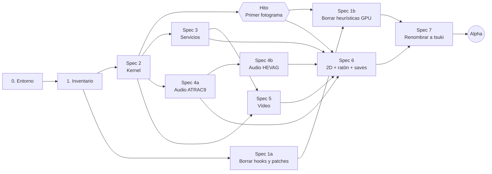

# tsuki_pc — Roadmap hasta la versión Alpha

Port nativo de **TSUKIHIME -A piece of blue glass moon-** (PS4) a PC, construido sobre el código del
port del juego anterior ([docs/gow3/ROADMAP.md](../gow3/ROADMAP.md)), que a su vez viene de
[bbport / bloodborne_pc](https://github.com/Supermedo/bloodborne_pc).

| | |
|---|---|
| Rama | `tsuki/main` (sobre el código del port del juego anterior) |
| Juego objetivo | TSUKIHIME -A piece of blue glass moon-, **CUSA47999**, versión **01.00** (`HP3279-CUSA47999_00-GAME000TSUKIHIME`) |
| Idioma objetivo | **Inglés** (el runtime ya reporta inglés al juego: `TSUKI_LANGUAGE`, valor 1 por defecto) |
| Plataforma | Linux primero (máquina de desarrollo), Windows 10/11 después; Vulkan 1.3 |
| Máquina de pruebas | Bazzite 44 (KDE Plasma 6.7, Wayland), AMD Ryzen 5 7600, 16 GB, **AMD Radeon RX 6650 XT** |
| Dump | `Tsukihime/CUSA47999/` (sin versionar, ~45 GB) |
| Última actualización | 2026-10-30 (**Spec 7 cerrada**, renombrado a `tsuki`; rama `tsuki/spec-7` fusionada en `tsuki/main` con fast-forward). **Hechas las cinco capas del renombrado:** variables `TSUKI_*`, archivos `tsuki_*`, símbolos y clases (`TsukiSettings`, `tsukigpu_*`), binarios (`tsuki-probe`), biblioteca de la GPU (`libtsukigpu.so`), `tsuki.ini`, la marca `tsuki:` en shadPS4 y esta documentación. Antes, la misma spec borró el upscaler temporal (FSR 3.1/4, DLSS y TAA, §12 de su spec); FSR 1 y RCAS siguen. Comprobado: el recorrido grabado y los fotogramas oráculo del arranque salen idénticos, y `build.sh --test` termina con `tools/check_rename.sh`. El usuario confirmó el título. El overlay de rendimiento ya mide en Linux CPU, RAM, GPU y VRAM (§9 de su spec). Windows sin probar. Hitos anteriores: Spec 1b y Spec 6 cerradas el 2026-10-28; Spec 5 el 2026-10-25; Spec 4 (4a ATRAC9 y 4b HEVAG) el 2026-10-21; Spec 1a y Spec 3 el 2026-10-19; primer fotograma el 2026-10-18; Spec 2 el 2026-10-17; el orden de las specs se revisó el 2026-10-14 tras un análisis adversarial. Quedan pendientes las revisiones adversariales de lo implementado en la Spec 4 (tarea 13 de su plan) y en la Spec 5 (tarea 8, paso 4), y 4 tests del launcher marcados como fallo esperado hasta después de la Alpha. El detalle de cada hito está en su sección de la etapa 5 y en su spec; el relato fechado completo, en la historia de git de este archivo. |

---

## Índice

1. [Cómo funciona el proyecto (versión simple)](#1-cómo-funciona-el-proyecto-versión-simple)
2. [Qué cambia respecto al juego anterior](#2-qué-cambia-respecto-al-juego-anterior)
3. [Definición de la Alpha](#3-definición-de-la-alpha)
4. [Visión general de las etapas](#4-visión-general-de-las-etapas)
5. [Etapas en detalle](#5-etapas-en-detalle)
6. [Riesgos](#6-riesgos)
7. [Pendientes del usuario](#7-pendientes-del-usuario)
8. [Después de la Alpha](#8-después-de-la-alpha)
9. [Glosario](#9-glosario)
10. [Referencias](#10-referencias)

---

## 1. Cómo funciona el proyecto (versión simple)

**No es descompilación ni emulación completa.** El ejecutable original del juego (`eboot.bin`) se ejecuta
sin modificaciones, directamente en el procesador del PC (la PS4 usa x86-64 AMD, igual que un PC).

El proyecto **imita el sistema de la PS4** alrededor del juego:

| Analogía web | En el proyecto | Dónde está |
|---|---|---|
| App compilada sin código fuente | Ejecutable del juego | `Tsukihime/CUSA47999/eboot.bin` |
| Script de build/deploy | Preparación: lee el ejecutable y genera una imagen lista para cargar | `scripts/prepare.py`, `scripts/link_modules.py` |
| Servidor que levanta la app | Loader: carga la imagen en memoria e inicia el juego | `src/probe.c` |
| Implementación falsa de las APIs del servidor | Runtime: reimplementa las APIs de la PS4 | `src/runtime_*.c` |
| Adaptador de base de datos | Traductor de gráficos: comandos de la GPU de la PS4 → Vulkan | `gpu/` (núcleo de shadPS4) |
| Error 404 con el nombre de la ruta | API inexistente → `STOP: first unsupported PS4 import: <nombre>` | `src/probe.c` |

El trabajo del port es: **implementar cada API que usa Tsukihime y que el port anterior no implementa,
eliminar todo lo específico del juego anterior y validar el camino 2D, de vídeo y de audio.**

---

## 2. Qué cambia respecto al juego anterior

Tsukihime es una **novela visual**: casi todo es 2D (fondos, sprites, texto), vídeo (openings,
títulos de capítulo, créditos) y audio (BGM, voces, efectos). El trabajo de rendimiento 3D del juego
anterior (readbacks, G-buffer, upscalers) importa poco; importan el texto, las transiciones, el vídeo y el
audio.

| Aspecto | Juego anterior | Tsukihime |
|---|---|---|
| ID / versión | ver [docs/gow3/ROADMAP.md](../gow3/ROADMAP.md) | CUSA47999 v01.00 |
| SDK | — | 11.008 (`sdk_ver=11008000`, publicado el 2025-09-19) |
| Imagen del eboot | — | 34 MB, entrada `0xef390`, relocaciones tipo 1/7/8 (dentro de los límites del loader) |
| Imports | 387 | 337 (359 quedan al runtime tras enlazar `libc.prx` y `libSceFios2.prx`) |
| Audio | AJM (ATRAC9 + MP3) | **libSceAudiodec + libSceAudiodecCpu** (no usa AJM): ATRAC9 en música, voces y efectos `vse`; **HEVAG** en los 19 efectos de `vag.mrg` |
| Vídeo | `sceVideodec` (H.264 de bajo nivel) | **`sceAvPlayer`** (134 `.mp4` en `image/movie/`, 4,5 GB) |
| Entrada | Mando, teclado | Mando, teclado **y ratón** (`libSceMouse`) |
| Datos | WAD | `image/*.hed/.mrg/.nam` (`allpac*`, `bgm`, `voice*`, `vag`, `se_nam`, `script_text`, fuentes `ft_*.mrg`) |
| Idiomas | — | ja, en, zc (chino simplificado), zt (chino tradicional), ko (fuentes); **el port solo apunta al inglés** |
| Módulos incluidos | `libc`, `libSceFios2` | `libc`, `libSceFios2`, `libSceNpToolkit2` (**el eboot no lo importa**: no hace falta enlazarlo) |
| Patches de la comunidad | Resolución, 120 FPS | Ninguno conocido |

### Qué se elimina (no se desactiva ni se adapta)

Todo lo que solo sirve al juego anterior se **borra del árbol**; no se deja código muerto detrás de
un interruptor. El juego anterior deja de ser un título soportado en esta rama (la historia sigue en git y en
la rama `gow3`).

- Hooks de orbes, daño, cheats y barra de vida del enemigo: los `install_*` de `src/probe.c`,
  `src/*_hook.h`, los backends de orbes y actores de `gpu/shim/`, y sus llamadas desde el
  overlay. *(Spec 1a, ✅ 2026-10-19: con ellos se fue la pestaña "Game" del menú del juego.)* Las del
  launcher se quitan al final (ver "Después de la Alpha").
- La herramienta de mapa de fotogramas del juego anterior (`tools/`). *(Spec 1a, ✅ borrada.)*
- El XML de parches del juego anterior (`patches/`), el perfil `GAMES` y `REFERENCE_SHA256` de
  `scripts/patches.py`, y `tools/make_signatures.py` si solo genera firmas del juego anterior. *(Spec 1a, ✅: el
  XML y el SHA están borrados y `GAMES` queda vacío. `make_signatures.py` se conserva porque es
  genérico: sirve para cualquier eboot y no lleva datos del juego anterior.)*
- Semántica del touchpad (modo foto / pausa) en `runtime_pad.c`. *(Spec 1a, ✅: `touchpad`,
  `touchpad_left` y `touchpad_right` son ahora nombres del mismo botón.)*
- Tests que solo inspeccionan código del juego anterior: `stat-multipliers-test`, `cheat-hooks-test`,
  `signatures-test` y los de Python que dependen del perfil del juego anterior. *(Spec 1a, ✅.)*
- Identidad del juego anterior: título y serial por defecto en `probe.c` y en `run.py`/`scripts/patches.py`.
  *(Spec 1a, ✅: además, cualquier juego que no sea CUSA47999 sale con código 30.)* El acceso de Steam,
  los textos del launcher y el empaquetado los cambió la Spec 7 (§11 de su spec); los README, el icono, la
  fuente de títulos y la paleta del launcher se dejan para el final (ver "Después de la Alpha").
- **Después de la Alpha** (decidido el 2026-10-19): la elección de parches de resolución y de frame rate usa todavía los nombres de los
  parches del juego anterior ("Resolution Patch", "Frame Rate Patch", "Bug Fix - Texture Corruption Fix"). Está
  en `scripts/patches.py`, `scripts/graphics_options.py`, `run.py`, el menú del juego y sus ajustes.
  Sin perfil de parches no hace nada, pero `run.py` sigue diciendo en cada arranque que no encontró el
  parche de frame rate. La Spec 1a no la cubría, y el launcher importa `EXCLUSIVE_PREFIX` de
  `patches.py`, así que se borra junto con el launcher (ver "Después de la Alpha").
- Heurísticas de GPU del juego anterior: `gbuffer_draw` y la constante de cámara de 864 bytes en
  `vk_rasterizer.cpp`; los hashes fijos de shaders del upscaler temporal; `TSUKI_READBACK_LINEAR=1` por defecto en
  `run.py`. *(Spec 1b, ✅ 2026-10-28)* El escalado a 1920×1080 **se conserva**: el proyecto trabaja de base a 1080p.
  *(Solo corría con el upscaler temporal; la Spec 7 los borró los dos, §12 de su spec, 2026-10-30.)*
  La decisión de MSAA por vendor también se conserva: es un parche para dos drivers de Windows, no del juego
  (decisión del 2026-10-25).

Lo que no es del juego anterior sino genérico (loader, runtime, núcleo de shadPS4, upscalers) se conserva.
*(Los upscalers temporales se borraron después en la Spec 7, §12 de su spec: sin entradas de este juego ya no
podían correr. FSR 1 y RCAS se quedan.)*

**Por qué el borrado va en dos tandas:** los hooks, patches y tests no tocan el renderizador y quitan
ruido del log, así que se borran pronto. Las heurísticas están dentro del núcleo de GPU
(`vk_rasterizer.cpp`, `liverpool.cpp`, `vk_pipeline_cache.cpp`): borrarlas sin ver un fotograma no
tiene forma de comprobarse. Se borran cuando el hito de primer fotograma deja una captura con la que
comparar antes y después.

---

## 3. Definición de la Alpha

### Objetivo

Tsukihime abre con el loader nativo, muestra los logos, reproduce el opening, llega al menú
principal, inicia una partida nueva y se puede leer **el prólogo hasta el primer título de
capítulo** (`phasetitle_01_00`), con texto, música, voces y control, y guardar y cargar la partida.

### Criterios de aceptación

Se separan según quién los comprueba. Los primeros se verifican con el log o con un test; los
segundos los juzga el usuario jugando.

**Se comprueban con log o test**

- [ ] El log (`user/last_run.log`) no contiene `STOP:` ni `Fault:` en el recorrido.
- [ ] El prólogo se recorre hasta `phasetitle_01_00` sin colgarse ni cerrarse. El recorrido se graba
  una vez con `TSUKI_PAD_RECORD` y se repite con `TSUKI_PAD_REPLAY`, para poder repetirlo tras cada cambio.
- [ ] El juego arranca en inglés: el log de archivos abiertos muestra recursos `_en` y la fuente
  `ft_en`, y ninguno de otro idioma.
- [ ] El save se graba y se carga tras reiniciar el juego (archivo de save presente y estado restaurado).
- [x] La decodificación de audio produce el mismo PCM que LibAtrac9 en un clip ATRAC9 de referencia, y el decodificador HEVAG pasa su test (tests C). *(2026-10-21, cierre de la Spec 4: `PASS: Audiodec contracts` con los cinco clips ATRAC9 y `PASS: HEVAG decoder` con las 19 entradas de `vag.mrg` iguales a `vgmstream-cli`.)*

**Los juzga el usuario**

- [ ] El juego muestra los logos y el opening en inglés (`op1_arc_en.mp4`) con vídeo y sonido.
  *(2026-10-24: el opening, sí; el usuario lo vio y lo oyó sincronizado (Spec 5, tarea 7). El logo `TM_CI`
  sale en cada arranque, entero o saltado con Cruz, pero el usuario aún no ha juzgado los logos.)*
- [ ] Llega al menú principal e inicia una partida nueva.
- [ ] El texto se ve correctamente y fondos, sprites y transiciones no tienen corrupción ni pantalla
  negra/blanca, según las capturas de línea base que el usuario ha aprobado (ver Spec 6).
- [ ] BGM, voces y efectos suenan sin chirridos ni cortes.
- [ ] Se avanza el texto con mando, teclado y ratón.

### Fuera de la Alpha

- Japonés, chino y coreano (si funcionan, mejor, pero no se prueban).
- Upscalers, motion vectors, patches de resolución o FPS.
- Launcher completo con identidad de Tsukihime.
- Trofeos reales, funciones de PSN, capturas/grabación/streaming del sistema.
- Windows y Steam Deck (solo si no salen gratis del build actual).
- Rutas completas y finales (eso es la Beta).

---

## 4. Visión general de las etapas

El orden sigue una regla: **primero lo que acerca el juego a pintar algo, luego lo que se puede
comprobar con eso, y lo que solo es limpieza, al final.**

La columna de esfuerzo es una **propuesta gruesa del autor, sin medir**, para tener un punto de
partida. Se corrigió al cerrar el hito de primer fotograma (2026-10-18), el primer momento con datos
reales: la Spec 1b baja de 2–3 a 1–2 días y la Spec 5 de 2–4 a 2–3 días; las demás no cambian. Los
motivos están en la sección "Hito".

| # | Etapa | Tipo | Depende de | Esfuerzo (propuesta) | Estado |
|---|---|---|---|---|---|
| 0 | Preparar el entorno (Linux) | Setup | — | — | ✅ Concluida |
| 1 | Inventario de APIs faltantes | Diagnóstico | 0 | — | ✅ Concluida |
| 2 | Kernel: event flags, tiempo, hilos (y lo mínimo de servicios para arrancar) | **Spec 2** | 1 | 3–5 días | ✅ Concluida (fases 2A y 2B; en libkernel solo quedan las 3 trampas decididas) |
| 3 | Borrar hooks, patches, touchpad, tests e identidad del juego anterior | **Spec 1a** | 1 (en paralelo con la Spec 2) | 1–2 días (real: 1 día) | ✅ Concluida el 2026-10-19 (otro juego sale con código 30; 4 tests del launcher marcados como fallo esperado hasta su limpieza; la elección de parches por nombre del juego anterior queda para después de la Alpha) |
| 4 | **Hito: primer fotograma** | Hito | Spec 2 | 1 día (real: ~1 día) | ✅ Concluido el 2026-10-18 (imagen correcta: el aviso de autoguardado y el vídeo del prólogo se ven bien; `unimplemented=0`; capturas PNG y `compare_captures.sh` con línea base en `out/baseline/`; se sigue el orden previsto) |
| 5 | Borrar las heurísticas de GPU del juego anterior | **Spec 1b** | Spec 1a, hito | 1–2 días (antes 2–3; real: del 25 al 28 de octubre) | ✅ Concluida el 2026-10-28 (`gbuffer_draw`, la constante de 864 y los hashes del upscaler borrados; de la lectura lineal, solo su valor por defecto; el escalado a 1080p y el MSAA por vendor se quedan; capturas idénticas y recorrido de la Spec 6 igual a `out/baseline/6a/`) |
| 6 | Servicios del sistema que faltan | **Spec 3** | Spec 2 | 2–3 días (real: 1 día, más las 15 adelantadas en la Spec 2) | ✅ Concluida el 2026-10-19 (23 de 23: 15 adelantadas en la Spec 2 y 8 en la Spec 3; `--check-imports` da 11, todos de las Specs 2 y 4) |
| 7a | Audio ATRAC9 (`libSceAudiodec`): música → voces → efectos `vse`, con investigación previa | **Spec 4a** | Spec 2 | 1–2 semanas, sin tope (real: 3 días de plan, del 19 al 21 de octubre, más el estudio del sitio de llamada del 17) | ✅ Concluida el 2026-10-21 (las seis funciones sobre LibAtrac9, bit-exactas contra LibAtrac9; **suenan bien la música, las voces y los efectos `vse`**; `--check-imports` sin Audiodec; arranque de 60 s sin `STOP:` ni errores de Audiodec) |
| 7b | Audio HEVAG (`libSceAudiodecCpu`): efectos de `vag.mrg`, con investigación previa | **Spec 4b** | Spec 4a (música y voces) | sin estimar, sin tope (real: 1 día, el 21 de octubre) | ✅ Concluida el 2026-10-21 (`QueryMemSize`, `InitDecoder` y `Decode` sobre el HEVAG de vgmstream, con el estado en la memoria de trabajo del guest; **los efectos de `vag.mrg` suenan bien**; 240 voces sin errores en el menú de título; queda la revisión adversarial de la tarea 13 del plan) |
| 8 | Vídeo (AvPlayer) | **Spec 5** | Specs 2 y 3 | 2–3 días (antes 2–4; real: 1 día de plan, el 24 de octubre, y el cierre el 25, más el estudio del cuelgue del 21) | ✅ Concluida el 2026-10-25 (**arreglado el cuelgue en `sceAvPlayerStop` del título del capítulo 1**, confirmado en el juego tres de tres veces y en el recorrido final; en el juego, el opening llega entero y sincronizado según el usuario, el prólogo a tiempo real, saltar el logo no cuelga y el fondo del menú de título ya no se acelera; los 134 vídeos se reproducen fuera del juego; queda la revisión adversarial, tarea 8 paso 4; sección Spec 5) |
| 9 | 2D correcto, ratón y saves | **Spec 6** | Hito (empieza), Specs 3, 4 y 5 (cierra) | 1–3 semanas (real: del 25 al 28 de octubre) | ✅ Concluida el 2026-10-28 (ratón, saves, idioma y render 2D; línea base `out/baseline/6a/` aprobada por el usuario y repetible con `tools/route.sh`; la miniatura pixelada es del juego y se deja; la comprobación tras la Spec 1b pasa a la 1b, decisión del usuario) |
| 10 | Renombrar el proyecto a `tsuki` | **Spec 7** | Specs 6 y 1b | 2–3 días | ✅ Cerrada el 2026-10-30 (fusionada en `tsuki/main`): recorrido y oráculo de arranque idénticos; el usuario confirmó el título; métricas del overlay en Linux hechas (§9 de su spec). Windows sin probar |

**Total: 8 specs (la 4 en dos partes) y 1 hito** (pueden crecer según lo que aparezca al ejecutar el juego).

Leyenda de estado: ⬜ Pendiente · 🟨 En curso · ✅ Concluida · ⛔ Bloqueada



### Lo que ya se hizo

| # | Entregado | Commit |
|---|---|---|
| — | Dump CUSA47999 v01.00 extraído (ShadPS4Plus `pkg_extractor`) en `Tsukihime/CUSA47999/`, ignorado en `.gitignore`. | — |
| — | `prepare.py` y `link_modules.py` procesan el eboot sin errores: 104 enlaces nativos a `libc`/`Fios2`, 359 imports para el runtime, 0 parches `fs→gs`. | — |
| 1 | Inventario estático (sección de la etapa 1): ~61 APIs sin implementación, 57 con nombre. | — |
| 2 | Spec 2 (kernel) cerrada: 26 de las 29 APIs de libkernel implementadas y 3 trampas con nombre; en la fase 2A se adelantaron 15 APIs de la Spec 3 y una provisional de la 4. | `2531937`…`7244263` |
| 3 | Spec 1a cerrada. Fuera del árbol: los hooks del juego anterior y sus backends, la pestaña "Game" del menú, el XML y el perfil de parches, el touchpad en dos mitades, los tests del juego anterior y los textos de identidad. El cargador solo arranca CUSA47999 (código 30 para cualquier otro). Los 4 tests del launcher que rompe quedan como fallo esperado. | `9f86fc1`…`4832164` |
| 4 | Hito de primer fotograma cerrado: línea `GPU:` al final del log, capturas PNG del fotograma presentado (`TSUKI_SCREENSHOT_AT`, F12), `tools/compare_captures.sh`, línea base en `out/baseline/` y decisión: seguir el orden previsto. | `8c40e39`…`5acfafe` y `0e6bf51` (cierre) |
| 5 | Spec 1b cerrada. Fuera del árbol: `gbuffer_draw` y la constante de cámara de 864 bytes, los hashes fijos de shaders del upscaler temporal (sustituidos por `UiComposition::Trigger`, que solo dispara con un hash configurado) y el valor por defecto de `TSUKI_READBACK_LINEAR` en `run.py`. Un contador temporal con las heurísticas encendidas dio 0 coincidencias, y las capturas del arranque y del recorrido de la Spec 6 salen idénticas tras los borrados. | `fe33d5e`…`13cba4c`, `61e34a3`…`0570722` y el cierre (`Docs(Spec1b): cierre de la Spec 1b`) |
| 6 | Spec 3 cerrada: las 23 APIs de plataforma con comportamiento explícito y probado. `tests/test_import_names.py` fija NID y nombre de cada una, y no se finge ninguna conexión a PSN ni a la red. | `f4a5d0a`…`5fcc578` |
| 7a | Spec 4a cerrada. `libSceAudiodec` decodifica ATRAC9 sobre LibAtrac9: música, voces y efectos `vse`, con el uso de la biblioteca documentado en `docs/audiodec.md`. Hay tests bit-exactos con los cinco clips de referencia, un fixture con los bloques de control reales y la reproducción de los flujos que vuelca una partida. `libSceAudiodecCpu` (HEVAG) responde con un error explícito hasta la Spec 4b. | `07800f5`…`6d82110` y el cierre (`docs(spec4): cierre de la parte 4a`) |
| 7b | Spec 4b cerrada. `libSceAudiodecCpu` decodifica los efectos HEVAG de `vag.mrg` con `decode_hevag` de vgmstream, adaptado en `third_party/vgmstream_hevag/` con su aviso ISC. El estado vive en la memoria de trabajo del guest, la voz acaba por la bandera 7 y el contrato está en `docs/audiodec.md` 2.6–2.7. Hay tests con las 19 entradas de `vag.mrg` frente a `vgmstream-cli` y con las rutinas del juego emuladas. | `e6d01e7`…`cd056d8` y el cierre (`docs(spec4): cierre de la parte 4b`) |
| 8 | Spec 5 cerrada. El AvPlayer de shadPS4 reproduce los vídeos del juego. Son ocho arreglos, cada uno con su caso rojo en `avplayer-test` o `kernel-thread-test`: la carrera de `Kernel::Thread` que colgaba `Stop` en el título del capítulo 1, el `StateStop` sin audio, `Start` con la reproducción en curso, `Stop` que rebobinaba el lector, `JumpToTime` real, el bucle, los últimos fotogramas con fotogramas B y el ritmo del bucle sin audio. El trazador `TSUKI_TRACE_AVPLAYER` dio el contrato del juego (`docs/avplayer.md`), y el arnés tiene un modo barrido para los 134 vídeos. | `c06b6a1`…`1ab2a94` y el cierre (`docs(spec5): cierre`) |

### Flujo de cada spec

1. Spec escrita (objetivo, contrato, casos de error, archivos, criterios de aceptación).
2. **Aprobación del usuario** (único punto de parada obligatorio).
3. Tests escritos antes del código, cuando la lógica no es trivial.
4. Implementación.
5. Validación: tests automáticos y ejecución real del juego. Si la spec toca el renderizador, se
   captura el mismo fotograma antes y después con la herramienta de captura de píxeles del hito y se
   comparan con `tools/compare_captures.sh`.
6. Puedes hacer commits y se actualiza el estado en esta página.

---

## 5. Etapas en detalle

> Desde la Spec 7 (2026-10-30) este documento usa los nombres nuevos (`TSUKI_*`, `tsuki-probe`, `libtsukigpu.so`),
> también en los pasos que se cerraron con los nombres anteriores.

### Etapa 0 — Preparar el entorno (Linux)

**Qué es:** confirmar que el proyecto, todavía sin cambios, compila en la máquina de desarrollo.

**Pasos**

1. ✅ Dependencias por pkg-config (vulkan, sdl3, ffmpeg). Bazzite es inmutable: compilar dentro de
   un contenedor (distrobox/toolbox de Fedora) con los `-devel` instalados, no con `rpm-ostree`.
2. ✅ `bash build.sh` y confirmar que existen `out/gpu/libtsukigpu.so` y `out/tsuki-probe`.
3. ✅ `bash build.sh --test` y `python3 -m unittest discover -s tests`; anotar la línea base.

**Listo cuando:** el build termina sin errores y la línea base de los tests está registrada.

**Resultado (2026-10-14):** distrobox `ps4dev` (Fedora 44, GCC del sistema, LTO activado, sin PGO).
Comandos y recreación del contenedor en `docs/ENTORNO.md`. Ajustes del entorno, dentro del
contenedor:

- Fedora 44 trae Vulkan-Headers 1.4.341 y shadPS4 usa `VK_VALVE_shader_mixed_float_dot_product`
  (1.4.344): se instala Vulkan-Headers v1.4.344 en `/usr/local`. *(Ya no hace falta desde el 2026-10-30: esa
  extensión solo la usaba el FSR 4.1.1, que la Spec 7 borró. `docs/ENTORNO.md`.)*
- ffmpeg completo de RPM Fusion en vez de `ffmpeg-free` (que no decodifica H.264 sin openh264;
  `videodec-test` fallaba). Hará falta igualmente para los `.mp4` de AvPlayer.

Cambios en el repo para compilar en Fedora:

- `gpu/CMakeLists.txt`: si no hay paquete CMake de Zydis (Fedora solo trae `zydis.pc`), se usa
  pkg-config.
- `build.sh --test`: `runtime-test` y `sema-test` compilaban `src/runtime*.c` sin
  `"${includes[@]}"`; en Fedora las cabeceras de ffmpeg están en `/usr/include/ffmpeg`.

**Línea base de tests:**

| Suite | Resultado |
|---|---|
| `bash build.sh --test` (C) | 10/10 PASS: pad, runtime, file-mods, sema, content, mp3, videodec, services, isa-emulate, isa-stub |
| `python3 -m unittest discover -s tests` | 238 ejecutados, OK, 37 saltados: 17 sin `iced-x86` (pip), 16 solo Windows/Tk, 2 sin dump del juego anterior, 2 registro de fuentes GDI (Windows) |
| `out/tsuki-probe --cpu-features` | `CPU: complete` (MOVBE/BMI1/LZCNT nativos, sin `isa_rewrite`) |
| `out/tsuki-probe --vulkan-only` | RX 6650 XT (RADV NAVI23): envío de comandos + readback de 4096 bytes PASS |

---

### Etapa 1 — Inventario de APIs faltantes

**Qué es:** primer contacto con el juego. No cambia código.

**Pasos**

1. ✅ `prepare.py` + `link_modules.py` sobre el dump.
2. ✅ Inventario estático: cruzar los imports con `src/import_names.inc`, el código del runtime y
   las tablas de shadPS4 en `gpu/`; nombres recuperados calculando el NID de nombres candidatos.
3. ✅ Confirmarlo con `out/tsuki-probe out/boot-linked.bin --app0 Tsukihime/CUSA47999 --check-imports`:
   61 imports sin implementación (2026-10-14), el mismo reparto por biblioteca que el inventario estático.
4. ✅ Intentar iniciar el juego (`TSUKI_GAME_DIR=Tsukihime/CUSA47999 python3 run.py`) y anotar el
   primer `STOP:`.
5. ✅ Ajustar las specs 2 a 5 con la lista real (Spec 2 reordenada; ver "Resultado del primer arranque").

**Resultado estático (2026-10-13):** 359 imports para el runtime; los 121 de GnmDriver, VideoOut y
AvPlayer existen en las tablas de shadPS4; **~61 sin implementación**.

| Biblioteca | Faltan | Funciones | Spec |
|---|---|---|---|
| libkernel | 29 | Event flags (Create, Delete, Wait, Set, Cancel); GetProcessTimeCounter(+Frequency); ConvertUtcToLocaltime / LocaltimeToUtc; IsNeoMode; `_sceKernelSetThreadDtors`, `SetThreadAtexitCount`, `SetThreadAtexitReport`; GetSanitizerMalloc/NewReplaceExternal, IsAddressSanitizerEnabled; InternalMemoryGetModuleSegmentInfo, GetModuleInfoForUnwind; Getdents, Utimes, Chmod; `scePthreadCancel`, `scePthreadGetname`; `pthread_rwlock_rdlock/wrlock/unlock`; 3 sin nombre (`NhpspxdjEKU`, `Tz4RNUCBbGI`, `8OnWXlgQlvo`; después: `_nanosleep` y `_sceKernelRtldThreadAtexitIncrement/Decrement`). **Cerrada (2026-10-17):** 26 hechas y 3 trampas con nombre (`scePthreadCancel`, `InternalMemoryGetModuleSegmentInfo`, `GetModuleInfoForUnwind`) | 2 |
| libSceAudiodec | 6 | InitLibrary, TermLibrary, CreateDecoder, DeleteDecoder, Decode, ClearContext | 4a |
| libSceAudiodecCpu | 3 | QueryMemSize, InitDecoder, Decode | 4b |
| libSceSaveData | 5 | Initialize3, Mount2, UmountWithBackup, CheckBackupData, RestoreBackupData | 3 |
| libSceScreenShot | 3 | Enable, Disable, SetOverlayImageWithOrigin | 3 |
| libSceSharePlay | 3 | Initialize, Terminate, SetProhibition | 3 |
| libSceGameLiveStreaming | 3 | Initialize, Terminate, EnableLiveStreaming | 3 |
| libSceVideoRecording | 1 | SetInfo | 3 |
| libSceSysmodule | 2 | GetModuleInfoForUnwind, LoadModuleInternalWithArg | 3 |
| libSceSystemService | 2 | ParamGetString, ReenableMusicPlayer | 3 |
| libSceUserService | 1 | GetUserColor | 3 |
| libSceMsgDialog | 1 | GetResult | 3 |
| libSceDiscMap | 1 | `fJgP+wqifno` (sin nombre) | 3 |
| libSceLibcInternalExt | 1 | `sceLibcHeapGetTraceInfo` | 3 |

**Qué significa "cubierta".** El inventario estático solo dice que una API *existe* en el runtime
(su NID tiene entrada en `import_names.inc` y su nombre o NID aparece en el código). No dice que
funcione. Desde esta revisión, una API se considera **cubierta** solo si tiene un test o si el juego
la llamó en un recorrido real; hasta entonces es "existe".

Bibliotecas que el runtime ya implementa (existen, sin verificar contra el juego): AudioOut, Pad,
PlayGo, NpTrophy, NpManager, SaveDataDialog, CommonDialog, Rtc, UserService (el resto),
SystemService (el resto).

**Mouse no está entre ellas.** `libSceMouse` es hoy un stub: `mouse_open` devuelve un identificador y
`mouse_read` nunca informa de un dispositivo conectado (`src/runtime_services.c`); los eventos de
ratón de SDL solo llegan al overlay de ImGui, y `gpu/shim/window.cpp` dice que el juego no tiene
ratón. Es trabajo nuevo y está en la Spec 6.
*2026-10-25: hecho en la Spec 6, bloque B. `src/runtime_mouse.c` entrega movimiento, botones y rueda, y el
juego lo usa.*

> Además, que la lista llegue a cero no garantiza que el juego abra: los cuelgues de sincronización
> y los defectos gráficos aparecen en el hito de primer fotograma y en las specs 5 y 6.

**Resultado del primer arranque (2026-10-14):** el loader mapea los 9 segmentos (37 MB, 42 319
relocaciones) y arranca el módulo `libc.prx`, pero se detiene **antes de ejecutar el juego**:

```
STOP: first unsupported PS4 import: rNhWz+lvOMU#libkernel (index 337)
Caller in linked module 0 (libc.prx): +0x790
Native libc initialization is incomplete; game entry has not run.
```

- `rNhWz+lvOMU` = **`_sceKernelSetThreadDtors`** (NID verificado con `nid()`), llamado desde la
  inicialización de `libc.prx`. Es el primer ítem de la Spec 2 y desbloquea el arranque; después
  aparecerán los siguientes `STOP:` uno por uno (el inventario estático sigue siendo la lista guía).
- `--check-imports` repite los 61 (2026-10-14), mismo reparto por biblioteca. Dos NIDs más
  resueltos: `fgxnMeTNUtY` = `sceKernelGetProcessTimeCounter`, `BNowx2l588E` =
  `sceKernelGetProcessTimeCounterFrequency`.
- Dos NIDs más resueltos al escribir las specs (2026-10-14, 166 nombres candidatos probados):
  `Tz4RNUCBbGI` = `_sceKernelRtldThreadAtexitIncrement` y `8OnWXlgQlvo` =
  `_sceKernelRtldThreadAtexitDecrement`. Siguen sin nombre `NhpspxdjEKU` (libkernel) y
  `fJgP+wqifno` (DiscMap). Se resuelven desde el sitio de llamada cuando aparezcan como `STOP:`
  (el log da "Caller return offset" y el primer argumento). *Resueltos después (Spec 2):
  `NhpspxdjEKU` = `_nanosleep` y `fJgP+wqifno` = `sceDiscMap_7C980FFB0AA27E7A`.*
- **Cinco de los 61 ya tienen código** y solo les falta su línea en `src/import_names.inc`
  (`runtime_lookup` no los encuentra sin ella): `sceKernelGetProcessTimeCounter`,
  `sceKernelGetProcessTimeCounterFrequency`, `sceSaveDataInitialize3`, `sceSaveDataMount2` y
  `sceMsgDialogGetResult`. El trabajo real baja a 56 APIs.
- Un import sin implementar solo detiene el juego **cuando se llama**, así que los 61 son un límite
  superior: el trabajo de la Spec 2 se guía por los `STOP:` y se cierra la lista al final.
- No hizo falta cambiar código. El perfil de parches responde "no patch profile for CUSA47999" y
  los hooks del juego anterior informan "code not found" (ruido que borra la Spec 1a). Sin `profile.bin` en
  la caché de pipelines (aviso inocuo en el primer arranque).
- Logs: `out/check-imports.log`, `out/first-run.log`.

**Listo cuando:** `--check-imports` confirma la lista y se conoce el primer `STOP:` real. ✅

---

### Spec 2 — Kernel: event flags, tiempo e hilos

> Spec detallada: [docs/specs/2026-10-14-spec-2-kernel.md](../specs/2026-10-14-spec-2-kernel.md)

**Problema:** faltan 29 APIs de `libkernel`. Las más importantes son los **event flags**, que el
runtime no implementa (están en la lista de "no implementado" del proyecto) y que el juego usa para
sincronizar hilos. Es la primera spec porque el juego no pasa de la inicialización de `libc.prx`
hasta que está hecha, y nada más (renderizado, audio, vídeo) se puede observar antes.

**Solución** (orden: lo primero que corta el arranque es `_sceKernelSetThreadDtors`, desde `libc.prx`)

0. `_sceKernelSetThreadDtors`, `SetThreadAtexitCount` y `SetThreadAtexitReport`, que bloquean la
   inicialización de `libc.prx`.
1. Event flags completos (Create, Delete, Wait con modos AND/OR y CLEAR, Set, Cancel, timeout).
   La semántica se toma del shadPS4 upstream; esa parte **no está vendorizada** en `gpu/shadps4/`
   (solo `equeue`), así que hay que consultarla en su repositorio.
2. Tiempo: `GetProcessTimeCounter(+Frequency)`, conversiones UTC ↔ hora local.
3. Hilos: variantes POSIX de `pthread_rwlock_*` (reutilizar `src/runtime_rwlock.c`, que ya existe),
   `scePthreadCancel`, `scePthreadGetname`, `_sceKernelSetThreadDtors/AtexitCount/AtexitReport`.
4. Respuestas explícitas: `IsNeoMode` = 0 (PS4 base, decidido el 2026-10-17), sanitizer desactivado,
   `Getdents`/`Utimes`/`Chmod` sobre los montajes del runtime. `scePthreadCancel` y la info de módulo
   para unwind quedan como trampa hasta que el juego las llame (decidido el 2026-10-17).
5. Identificar los 3 NIDs sin nombre (desensamblar el sitio de llamada o buscar en aerolib).
6. **Servicios mínimos para arrancar:** si el siguiente `STOP:` es de una API de la Spec 3
   (por ejemplo `Sysmodule` o `SystemService`), se adelanta aquí lo imprescindible para seguir. El
   resto de esa spec espera.

**Archivos afectados:** `src/runtime_thread.c`, `src/runtime_rwlock.c`, `src/runtime_mutex.c`, nuevo
módulo o sección para event flags, `src/runtime_file.c`, `src/import_names.inc`, `tests/test_sema.c`
u otro test C.

**Requisitos**

- Cuando un hilo espere un event flag, el sistema debe despertarlo exactamente cuando se cumpla la
  condición o expire el timeout, con los códigos de error de la PS4.
- Nunca se debe fingir éxito en una API cuyo resultado el juego use.

**Estado (2026-10-17):** hechos los callbacks de hilo de libc, las respuestas del sanitizer y de Neo,
`_nanosleep`, los nombres de ProcessTimeCounter y los event flags. Además se adelantaron de la Spec 3
`sceLibcHeapGetTraceInfo` y, en las diez iteraciones de la fase 2A, 14 APIs más: `ParamGetString`,
`LoadModuleInternalWithArg`, tres de SaveData (`Initialize3`, `Mount2` y `UmountWithBackup`), una de
DiscMap y las ocho "sin efecto" de Share Play, streaming, capturas y grabación.
La sección 4.1 de la spec tiene el registro completo. El juego pasa la init de `libc` y de Fios2 y
entra en su código sin volver a pararse en libkernel. Llama a Audiodec **antes del primer draw**; se
le responde con un error provisional, que el juego ignora.

La fase 2A terminó en la iteración 10. Ya no hay `STOP:`: el juego abre `VideoOut`, llama a
`sceGnmSubmitAndFlipCommandBuffers` ~60 veces por segundo y reproduce `prologue_en.mp4` por AvPlayer.
Quedaban la fase 2B (cerrar libkernel para `--check-imports`; hecha, ver abajo) y el hito (saber qué se dibuja).

Después, sin watchdog (`out/run-prologo.log`), el juego reproduce entero el vídeo del prólogo
(6 min 29 s) y luego para en `sceAudiodecCreateDecoder`, de la Spec 4a. Sigue sin aparecer ningún
`STOP:` de libkernel. El prólogo no se pudo saltar con Options, Cruz ni Círculo, así que cada prueba
de lo que viene después cuesta esos 6 min 29 s. Registro en la sección 4.1 de la spec.

*2026-10-20: con ATRAC9 (Spec 4a) el juego pasa del prólogo y guarda progreso en su partida. Desde
entonces el arranque va directo al menú de título, sin el vídeo, y ya no cuesta esos 6 min 29 s. Para
volver a ver el prólogo hay que restaurar la partida sin progreso (`out/savedata-sin-progreso/`).*

**Fase 2B (2026-10-17, `7244263`): spec cerrada.** Se miró el sitio de llamada de las 12 que faltaban
antes de escribir código. Todas menos `scePthreadCancel` las llama solo `libc.prx`:

- `pthread_rwlock_*` POSIX: el lock de su tabla de módulos.
- `scePthreadGetname`: el informe de `atexit` por hilo.
- `ConvertUtcToLocaltime`/`LocaltimeToUtc`: `localtime`, `mktime` y `strftime %z`, con el desfase del
  host y el horario de verano incluido, como `sceKernelGettimezone`.
- `Getdents`/`Utimes`/`Chmod`: su `<filesystem>`, con `/app0` de solo lectura.

Las tres trampas decididas tienen ya nombre, así que su `STOP:` dice qué API es. `--check-imports` no
lista nada más de libkernel, y una ejecución de 60 s se comporta como la de la iteración 10. Queda
abierto: las ramas Windows nuevas no se han compilado, y `tm_isdst` sale siempre 0 (spec, sección 9).

**Criterios de aceptación**

- [x] Test C de event flags: AND, OR, CLEAR_ALL, CLEAR_PAT, timeout, cancel, varios hilos.
- [x] El juego pasa del arranque a los logos sin `STOP:` de libkernel. *Sin logos todavía: el
  arranque llega sin `STOP:` de libkernel al aviso de autoguardado y al vídeo del prólogo, y lo
  siguiente para en `sceAudiodecCreateDecoder` (Spec 4a). Se comprueba cuando la 4a deje pasar del
  prólogo. No depende de más trabajo de esta spec. 2026-10-20: ya pasa y llega al menú de título; la
  casilla se revisa en la tarea 9 del plan de la Spec 4.* *2026-10-21 (cierre de la 4a): **cumplida.**
  En un arranque de 60 s con la partida actual no hay ningún `STOP:`, de libkernel ni de otra
  biblioteca (`out/spec4-t9-boot60.log`). Las capturas (`out/spec4-t9-shots/`) muestran:*
  1. *el aviso de autoguardado;*
  2. *un fundido claro, que es **[H]** el logo de TYPE-MOON (`TM_CI.mp4`), sin confirmar porque el log
     no nombra los vídeos que abre AvPlayer;*
  3. *la advertencia legal;*
  4. *el menú de título, hacia los 20 s.*

  *Con la partida sin progreso sale el prólogo en lugar del menú.*
- [x] Se llega al hito de primer fotograma (ver abajo): el juego presenta fotogramas (2026-10-17). La
  captura y la decisión son del hito.

---

### Spec 1a — Eliminar hooks, patches, touchpad, tests e identidad del juego anterior

> Spec detallada: [docs/specs/2026-10-14-spec-1a-borrar-hooks-y-patches.md](../specs/2026-10-14-spec-1a-borrar-hooks-y-patches.md)

**Problema:** el código asume el juego anterior en el título, el serial, los patches, los hooks y los
tests. Dejarlo desactivado confunde el diagnóstico (el log de arranque ya muestra diez líneas de
"code not found") y obliga a mantenerlo compilando. Esta parte no toca el renderizador, así que se
puede hacer en paralelo con la Spec 2 y sin ver el juego.

**Solución:** borrar lo marcado *(Spec 1a)* en la sección 2, dejar un único título soportado
(CUSA47999) y leer el título y el serial del `param.sfo`. **No se renombra nada todavía.**

**Orden de trabajo** (un paso por vez, compilando y pasando tests entre pasos)

1. Hooks y backends: `install_*` en `src/probe.c`, `src/*_hook.h`, los `*_orbs.cpp` y
   `*_actors.cpp` del juego anterior, y lo que los referencie en el overlay y la configuración.
2. Patches: XML, perfil `GAMES`, `REFERENCE_SHA256`; el cargador de patches queda genérico (sin
   perfil, no aplica ninguno).
3. Entrada: touchpad de `runtime_pad.c`.
4. Tests: borrar los del juego anterior y ajustar los genéricos (`test_patches.py`, etc.).
5. Identidad: título y serial por defecto. El launcher, el acceso de Steam y el empaquetado no se
   tocan (quedan para el final).

**Archivos afectados:** los listados arriba, más `CMakeLists.txt` (`gpu/`) y `build.sh` para quitar
los tests y fuentes eliminados.

**Requisitos**

- El árbol no debe contener hooks, patches ni firmas del juego anterior.
- Cuando el juego no sea CUSA47999, el sistema debe rechazarlo con un mensaje claro en el log.
- Lo genérico (loader, runtime, núcleo de shadPS4, upscalers) no debe cambiar de comportamiento.

**Criterios de aceptación**

- [x] `bash build.sh --test` y `python3 -m unittest discover -s tests` pasan, con la línea base de
  la etapa 0 como referencia (menos los tests borrados, que se listan).
  *(2026-10-19: C pasa. Python: 255 ejecutados y 35 omitidos; solo fallan 4 tests del launcher,
  que la spec deja anotados sin arreglar y que están marcados con `@unittest.expectedFailure`. Las diferencias están en la sección 6 de la spec.)*
- [x] Comprobación de símbolos con una **lista cerrada y coincidencia de palabra completa**
  (`git grep -nw`), por ejemplo los seriales del juego anterior, el nombre de su XML de parches,
  `REFERENCE_SHA256` y los nombres de los `install_*` borrados. La lista exacta se fija al escribir
  la spec. No se usan términos sueltos como `orb` o `damage`, que coinciden con `LICENSE`, las
  cabeceras de FSR y cualquier "absorb". *(2026-10-19: 0 resultados.)*
- [x] El log de arranque de Tsukihime no menciona hooks ni patches y, por lo demás, es igual al de
  antes del cambio (se comparan `out/first-run.log` antes y después: mismo punto de parada).
  *(2026-10-19: sin las líneas de hooks y con la misma parada. Siguen las dos líneas `Patches:` del
  cargador genérico, que la spec pide, y el aviso de `run.py` de que no encontró el parche de frame
  rate, que va con la elección de parches por nombre y se quita después de la Alpha.)*
- [x] Un juego que no sea CUSA47999 se rechaza con mensaje claro (test). *(2026-10-19:
  `STOP: unsupported title <id|unknown>: this build only runs CUSA47999`, código 30;
  `tests/test_probe.py`.)*

**Resultado (cerrada el 2026-10-19).** Los detalles de cada paso están en la spec.

- **Orden real:** pasos 0, 1, 4, 2, 3 y 5. El 4 (tests) va antes que el 2 porque borrar el XML rompía
  `test_patches.py`.
- **Paso 1, hooks:** se borran con su pestaña "Game" del menú del juego, que solo tenía cheats,
  multiplicadores y la barra de vida. Las claves del juego anterior que queden en el `.ini` se ignoran sin error.
- **Paso 2, parches:** el cargador queda genérico y dice en el log
  `Patches: no patch profile for CUSA47999: none applied`. La carpeta de juego por defecto es
  `Tsukihime/CUSA47999`.
- **Paso 3, touchpad:** los tres nombres son un solo botón, que el juego recibe al momento y sin toque
  sintético. Por defecto lo pulsan `Tab` y el clic real del touchpad.
  - Si se asigna más de un nombre, las fuentes se suman, así que los mapas que guarda el launcher
    siguen sirviendo.
  - El clic real no se pierde aunque se asigne un nombre.
- **Paso 5, identidad:** el título y el serial se leen del `param.sfo`. Con `--app0`, cualquier otro
  juego, o una carpeta sin `TITLE_ID`, sale con código 30 antes de montar nada o abrir la ventana.
- **Tests:**
  - C: `bash build.sh --test` pasa. `pad-map-test` entra en él; antes solo existía para Windows.
  - C++: faltan los 6 destinos borrados, y `graphics-settings-test` y `perf-overlay-test` ya compilan
    en Linux.
  - Python: `OK (skipped=35, expected failures=4)` en 255 tests.
- **Log y capturas:** el log de arranque pierde las líneas de hooks y para en el mismo punto. En las
  capturas, el fotograma 300 sale idéntico al control del hito. El 120 y el 420 solo difieren en el
  icono "Saving…", que gira, y del 720 en adelante es el vídeo del prólogo (unos 6 minutos), que no se
  puede repetir.
- **Consecuencias en lo que no se tocó:**
  - El launcher ya no reconoce un dump, porque usaba el perfil del juego anterior.
  - El empaquetado copia `patches/` con `cp -r`, y esa carpeta ya no existe.
  - Las dos cosas van con la limpieza de después de la Alpha.
- **Después de la Alpha:** la elección de parches por nombre del juego anterior (decidido el 2026-10-19; ver la sección 2).
- **Esfuerzo:** 1 día, el mínimo de lo previsto.

---

### Hito — Primer fotograma

> Spec detallada: [docs/specs/2026-10-14-hito-primer-fotograma.md](../specs/2026-10-14-hito-primer-fotograma.md)

**Qué es:** el momento en que el juego, tras la Spec 2, llega a emitir comandos de dibujo. No es una
spec: es un punto de control para decidir el resto con datos reales. Hoy no hay ninguna señal sobre
cómo dibuja este juego en el traductor de GPU, y es la mayor incógnita del proyecto.

**Pasos**

1. Ejecutar el juego tras la Spec 2 hasta que aparezca algo en pantalla (logo, fondo negro con
   draws) o hasta el siguiente `STOP:`.
2. Capturar los primeros fotogramas y guardarlos en `out/baseline/` (**no se versionan**: son imágenes
   del juego). `TSUKI_FRAME_CAPTURE_KEY=1` + F11 **no sirve para esto**: escribe una lista de pasos en
   texto, no una imagen, y el proyecto no tiene captura de píxeles en PNG (se quitó al vendorizar el
   presentador). Sí existe un volcado en bruto (`TSUKI_FRAME_DUMP_TRIGGER`, archivos `.raw`), que la
   herramienta nueva reutiliza (revisado el 2026-10-18). Hacer esa herramienta, **en proceso**
   (decidido el 2026-10-14), es un entregable del hito (ver su spec, que desde el 2026-10-18 incluye el
   plan de implementación en la sección 7).
3. Anotar los avisos de GPU del log (`Unimplemented ...`, formatos no soportados, etc.).
4. Decidir según el resultado:

| Resultado | Qué se hace |
|---|---|
| Se ve bien (logo legible, colores correctos) | Seguir con el orden previsto |
| Se ve mal o negro, pero hay draws | Abrir una spec de renderizado **antes** de las specs 4 y 5 |
| No llega a pintar | Es el siguiente `STOP:` o `Fault:`: volver a las specs 2 y 3 (o a la fase A de la Spec 4a si lo que bloquea es Audiodec, que se llama antes del primer draw) |

5. **Revisar este roadmap:** re-estimar el esfuerzo de las specs restantes con lo que se haya visto.

**Listo cuando:** hay al menos una captura del juego en `out/baseline/` y una decisión anotada.

**Resultado (cerrado el 2026-10-18).** Los detalles están en la spec, secciones H1 a H4 y 7.

- **Qué se ve.** El juego muestra primero el aviso de autoguardado: es su propio 2D, con texto nítido
  con antialiasing, colores correctos y el icono animado de "Saving…". Después viene el vídeo del
  prólogo, con la imagen y los subtítulos en inglés correctos. Ni franjas ni corrupción.
- **Log.** Un barrido de 60 s termina con
  `GPU: submits=7090 draws=147129 dispatches=0 flips=3545 unimplemented=0`. Los únicos avisos son 5 de
  formatos que la tarjeta no soporta y 1 de una extensión que falta, ninguno del juego.
- **Herramientas nuevas.**
  - Capturas PNG del fotograma presentado: `TSUKI_SCREENSHOT_AT=<n,…>` o la tecla F12.
  - `tools/compare_captures.sh`: compara exacto, sin tolerancia.
  - Para capturas comparables hay que lanzar siempre con `TSUKI_FULLSCREEN=1`, porque la captura tiene
    el tamaño de la ventana.
  - Comandos en `docs/ENTORNO.md`.
- **Línea base.** `out/baseline/` tiene 10 capturas, una cada 300 fotogramas entre el 120 y el 2820.
- **Determinismo.**
  - El aviso, pedido por número de fotograma, sale idéntico en dos ejecuciones (fotograma 300).
  - El vídeo no: AvPlayer sigue el reloj real, y el fotograma 1620 da `PSNR=31.9` entre ejecuciones
    (misma escena, otro instante).
  - Por tanto, las comparaciones píxel a píxel valen para el 2D del juego. El vídeo solo se puede
    comparar a ojo.
- **Decisión: primera fila de la tabla, se sigue el orden previsto.** No hace falta una spec de
  renderizado.
- **Límite de lo visto.** La ventana de texto, los fondos, los sprites y los fundidos llegan después
  del prólogo, y el juego para antes en `sceAudiodecCreateDecoder`. Hasta que la Spec 4a (fase A) deje
  pasar del prólogo, la Spec 6 y la Spec 1b solo pueden comparar el aviso y el vídeo.
  *2026-10-20: ya pasa. Con la partida actual, que tiene progreso, el arranque llega al menú de título
  en segundos y sin el vídeo; con la partida sin progreso (`out/savedata-sin-progreso/`) sale el vídeo.*
  *2026-10-21 (cierre de la Spec 4a): el 2D de después del prólogo ya se ve y se puede capturar
  (`out/spec4-t9-shots/`, ventana sin pantalla completa):*
  - *Sin entrada, salen el aviso de autoguardado (fotogramas 30–420), un fundido claro (600), la
    advertencia legal (900) y el menú de título (1200).*
  - *Con entrada, salen el menú de carga y escenas de la novela con fondo, sprites y texto en inglés.*

  *A ojo se ven bien. Aprobarlas como línea base es de la Spec 6.*
- **Re-estimación.** El hito costó ~1 día, como se preveía.
  - Spec 1b: de 2–3 a 1–2 días. La captura y la comparación ya existen y hay una escena repetible.
  - Spec 5: de 2–4 a 2–3 días. El vídeo ya se ve bien; quedan la sincronía, saltarlo con botones y la
    velocidad.
  - Specs 1a, 3, 4a, 4b, 6 y 7: sin cambios. Casi todo el 2D de la novela sigue sin verse, así que la
    Spec 6 mantiene sus 1–3 semanas.

---

### Spec 1b — Eliminar las heurísticas de GPU del juego anterior

> Spec detallada: [docs/specs/2026-10-14-spec-1b-heuristicas-gpu.md](../specs/2026-10-14-spec-1b-heuristicas-gpu.md)

**Problema:** el traductor de GPU conserva ajustes pensados paral juego anterior: `gbuffer_draw`, la
constante de cámara de 864 bytes, los hashes fijos de shaders del upscaler temporal y `TSUKI_READBACK_LINEAR=1` por
defecto (el escalado a 1920×1080 se conserva: 1080p es la resolución base del proyecto). La decisión de MSAA por
vendor estaba en la lista, pero salió del alcance el 2026-10-25 (spec §2.2): es un parche de drivers de Windows. Están
dentro del núcleo (`vk_rasterizer.cpp`,
`liverpool.cpp`, `vk_pipeline_cache.cpp`, `videoout/driver.cpp`) y borrarlos sin ver un fotograma no
tiene forma de comprobarse. Por eso esta spec va después del hito.

**Solución:** borrarlas una a una, con el mismo fotograma capturado antes y después de cada borrado.

**Orden de trabajo**

1. Con las heurísticas aún presentes, capturar los fotogramas del hito (ya están en `out/baseline/`).
   Para comparar píxel a píxel sirve el aviso de autoguardado pedido por número de fotograma (por
   ejemplo `TSUKI_SCREENSHOT_AT=300`, con `TSUKI_FULLSCREEN=1`). Los fotogramas del vídeo cambian entre
   ejecuciones porque siguen el reloj real (ver el resultado del hito). Al cerrar la Spec 1a se
   confirmó con datos:
   - El 300 sale idéntico entre ejecuciones.
   - El 120 y el 420 solo difieren en un recuadro de unos 72×68 px alrededor del icono "Saving…", que
     gira.
   - El vídeo del prólogo dura unos 6 minutos, así que para ver otro 2D del juego hace falta pasar del
     prólogo.
   - *2026-10-20: la partida de `user/` ya tiene progreso, y el arranque va al menú de título sin el
     vídeo (si el aviso de autoguardado sigue saliendo antes no se ha comprobado con capturas). Los fotogramas de `out/baseline/` del 720 en adelante (vídeo) ya no corresponden a
     ese arranque: o se restaura la partida sin progreso (`out/savedata-sin-progreso/`), o se toma una
     línea base nueva con la partida actual. Una comparación debe arrancar siempre con la misma partida.*
   - *2026-10-21 (cierre de la Spec 4a): con la partida actual, **el aviso de autoguardado sigue
     saliendo** (fotogramas 30–420), y le siguen un fundido claro (600), la advertencia legal (900) y el
     menú de título (1200) (`out/spec4-t9-shots/`). La advertencia legal es 2D estático y sirve para
     una línea base nueva. Que salga idéntica entre ejecuciones no se ha comprobado. El menú de título
     sale sin entrada, pero su fondo es **[H]** un vídeo (`titlebg*.mp4`, AvPlayer se llama ahí). Las
     escenas de la novela piden entrada del jugador: para repetirlas hace falta
     `TSUKI_PAD_RECORD`/`TSUKI_PAD_REPLAY`.*
2. Borrar una heurística, compilar, pasar tests y recapturar.
3. Comparar las capturas (diferencia de píxeles). Si cambian, entender por qué antes de seguir; si el
   cambio es el esperado (la heurística actuaba sobre algo del juego anterior), anotarlo y actualizar la línea base.
4. Repetir con la siguiente. Valores por defecto de `run.py` y `scripts/graphics_options.py` al final.

**Requisitos**

- Lo genérico (loader, runtime, núcleo de shadPS4, upscalers) no debe cambiar de comportamiento
  salvo lo explicado en el paso 3.
- La heurística de MSAA por vendor **se queda** (decisión del 2026-10-25, spec §2.2), y de la lectura lineal solo se
  quita el valor por defecto de `run.py`: la opción de shadPS4 se queda. La documentación del defecto RDNA2
  (`docs/gow3/plans/2026-10-12-gpu-corruption-rdna2.md`) se conserva como historia.

**Criterios de aceptación**

- [x] `bash build.sh --test` y `python3 -m unittest discover -s tests` pasan.
- [x] `out/tsuki-probe --vulkan-only` sigue en PASS en la RX 6650 XT.
- [x] Las capturas antes y después de cada borrado son idénticas o la diferencia está explicada por escrito.
- [x] La comprobación de símbolos (lista cerrada, `git grep -nw`) no encuentra `gbuffer_draw` ni la
  constante de 864 bytes (ni los hashes del upscaler).
- [x] *(Viene de la Spec 6, 2026-10-28.)* El recorrido grabado se repite tras los borrados y coincide con
  `out/baseline/6a/` (`tools/compare_route.sh` sale con 0).

**Resultado (2026-10-28):** cerrada. Detalle en la spec, §7.

- Borrado: la lectura lineal por defecto (Tarea 4, 2026-10-25), `gbuffer_draw` y la constante de 864 bytes (Tarea 3)
  y los hashes fijos del upscaler (Tarea 3b), cada uno en su commit.
- Prueba: un contador temporal con `CameraMotion` y el upscaler encendidos (con el interruptor experimental, ya quitado) dio 0
  coincidencias en 272 268 draws del arranque y 5 165 990 del recorrido. Tras cada borrado, los cuatro fotogramas
  oráculo del arranque salen idénticos, con el upscaler apagado y encendido. El recorrido de la Spec 6 sale igual a
  `out/baseline/6a/`. Los dos fotogramas del menú de carga solo cambian en el vídeo de fondo; se revisaron a ojo.
- Receta de recaptura: `out/spec1b-t3/run-oracle.sh`, con la partida fija `out/savedata-usuario-1b/` en un
  `TSUKI_USER_DIR` propio y `TSUKI_MOUSE=0`, porque desde la Spec 6 la partida de `user/` cambió y el juego ve un ratón.
- Consecuencia: sin `gbuffer_draw`, `CameraMotion` se queda sin entradas, y el upscaler temporal (FSR 3.1/4, DLSS,
  TAA) ya no puede escalar con Tsukihime. **[D] 2026-10-28:** el código se queda; las opciones que lo encienden se
  quitan en la Spec 7 (§10 de su spec). *(Cambiado el 2026-10-30: la Spec 7 borró también el código, §12.)*

---

### Spec 3 — Servicios del sistema que faltan

> Spec detallada: [docs/specs/2026-10-14-spec-3-servicios.md](../specs/2026-10-14-spec-3-servicios.md)

**Problema:** APIs de plataforma que un juego offline no necesita de verdad, pero que el juego
llama: capturas, Share Play, streaming, grabación, saves con copia de seguridad, etc.

**Solución:** implementar cada una con un comportamiento explícito y documentado:

| Área | Comportamiento |
|---|---|
| ScreenShot, VideoRecording, GameLiveStreaming, SharePlay | Aceptan la llamada y no hacen nada (consola sin esas funciones); streaming "no activo" |
| SaveData `Initialize3`, `Mount2` | Igual que las variantes ya implementadas |
| SaveData con backup | `UmountWithBackup` = desmontar; `CheckBackupData` y `RestoreBackupData` = `NOT_FOUND` ("no hay backup") |
| SystemService `ParamGetString` | Nombre de usuario / valores del sistema; `ReenableMusicPlayer` sin efecto |
| UserService `GetUserColor` | Color fijo del usuario 1 |
| MsgDialog `GetResult` | Resultado del diálogo del overlay |
| Sysmodule | `LoadModuleInternalWithArg` como la carga interna existente; `GetModuleInfoForUnwind` = error explícito, sin datos inventados |
| DiscMap, LibcInternalExt | Comportamiento de shadPS4 |

Cada API de comportamiento "sin efecto" escribe una línea en el log la primera vez que el juego la
llama (`Service: <nombre> accepted, no effect`). Así no son stubs silenciosos y se ve cuáles usa el
juego de verdad. El runtime ya tiene 39 entradas de ese tipo (`ok_void`); esta spec no añade más sin
esa línea de log.

**Archivos afectados:** `src/runtime_services.c`, `src/runtime_savedata.c`, `src/runtime_content.c`,
`src/import_names.inc`, `tests/test_services.c`, `tests/test_runtime.c`, `tests/test_content.c`,
`tests/test_import_names.py`.

**Requisitos**

- El sistema nunca debe fingir que PSN está conectada.
- Cuando el juego abra un diálogo del sistema, el sistema debe concluirlo con el resultado
  documentado y registrarlo en el log.
- Si el juego usa el valor devuelto por una API "sin efecto" para decidir algo, deja de ser "sin
  efecto" y se implementa de verdad.

**Criterios de aceptación**

- [x] `--check-imports` no lista ninguna de las 23 (2026-10-19: da 11, los 8 de Audiodec de la Spec 4 y
  las 3 trampas decididas de la Spec 2). El criterio original pedía 0 faltantes junto con las Specs 2 y 4,
  pero con esas tres trampas el total no puede llegar a 0.
- [x] Las APIs nuevas tienen test: `services-test` (las tres "sin efecto" y `GetUserColor`), `runtime-test`
  (copias de seguridad) y `content-test` (`GetModuleInfoForUnwind`), cada una donde se compila su código.

**Resultado (2026-10-19).** Spec cerrada en 7 tareas (`f4a5d0a`…`5fcc578`). El detalle de cada API, con su
sitio de llamada, está en la spec.

---

### Spec 4 — Audio: ATRAC9 (4a) y HEVAG (4b)

> Spec detallada: [docs/specs/2026-10-14-spec-4-audiodec.md](../specs/2026-10-14-spec-4-audiodec.md)
> (replanteada el 2026-10-17)

**Problema:** Tsukihime no usa AJM sino `libSceAudiodec` y `libSceAudiodecCpu`, que el runtime no
tiene. El inventario del dump (2026-10-17) muestra que **casi todo es ATRAC9**: la música (`bgm.mrg`,
132 pistas estéreo), las voces (`voice.mrg`, mono, comprimidas con MZX, que el juego quita antes de llamar a Audiodec: tarea 8) y los efectos de `vse.mrg`
(1327). Solo **19 efectos de `vag.mrg` son HEVAG**. No hay MP3 ni AAC. El juego llama a
`sceAudiodecInitLibrary(1)` al arrancar, antes del primer draw; hoy recibe un error provisional, que
ignora.

`sceAudiodecCreateDecoder` no llega hasta el final del vídeo del prólogo, y es hoy lo que para el
juego (2026-10-17). Por tanto, Audiodec no bloquea el hito, pero sí impide pasar del prólogo.
*(2026-10-20: ya no lo impide. Con las tareas 3–6 el juego pasa del prólogo y guarda progreso, y
desde entonces arranca directo en el menú de título, donde llega el primer `CreateDecoder` en
segundos. El prólogo solo sale con la partida sin progreso, `out/savedata-sin-progreso/`.)* El
desensamblado de su sitio de llamada ya da varios datos (spec, sección 2.5):

- el bloque de control: parámetros ATRAC9 con los 4 bytes de configuración del RIFF, info del
  flujo, y entrada y salida con descriptores de 0x18 bytes, la misma forma que el PR #5289 da para
  `AudiodecCpu`;
- que la biblioteca devuelve los bytes consumidos en el tamaño de la entrada;
- que el juego no llama a `Decode` si el identificador es negativo.

Falta confirmarlo con el trazador de la fase A.

- **4a, ATRAC9 por `libSceAudiodec`:** el decodificador existe (LibAtrac9), pero las estructuras de
  esta biblioteca **no tienen referencia**: hay que deducirlas del juego.
- **4b, HEVAG por `libSceAudiodecCpu`:** el PR #5289 de shadPS4 (abierto, probado con este juego) trae
  estructuras, ids de códec (`Hevag 0x1008`) y errores. El decodificador se adapta de vgmstream
  (`decode_hevag`, licencia tipo ISC).

**Orden [decidido por el usuario, 2026-10-17]:** música → voces → efectos. Primero 4a y después 4b.
**Sin tope de tiempo** (decidido el 2026-10-14; es un experimento y un hobby).

**Solución**

*Spec 4a:*

1. Fase A: trazador `TSUKI_TRACE_AUDIODEC` (argumentos y volcado de las estructuras) con respuestas
   provisionales de error; desensamblar los sitios de llamada; escribir `docs/audiodec.md` (apartado
   ATRAC9) con las estructuras, la secuencia y los errores.
2. Fase B: `CreateDecoder`, `Decode`, `ClearContext`, `DeleteDecoder` y `TermLibrary` sobre LibAtrac9
   (`third_party/LibAtrac9`, con `src/runtime_ajm.c` como plantilla). Primero la música, después las
   voces y luego `vse`.

*Spec 4b (cuando ya suenan la música y las voces):*

3. Fase A: el mismo trazador sobre `QueryMemSize`, `InitDecoder` y `Decode`, contrastado con el PR
   #5289; apartado HEVAG de `docs/audiodec.md`.
4. Fase B: decodificador HEVAG adaptado de vgmstream, conservando su aviso de licencia.

En las dos: códec no soportado → `STOP:` con el número, nunca silencio.

**Archivos afectados:** `src/runtime_audiodec.c` (ya existe, con la respuesta provisional), nuevo
`src/runtime_audiodec_cpu.c`, el decodificador HEVAG, `src/runtime.c` (registro),
`src/import_names.inc`, `docs/audiodec.md`, build y tests C con clips de referencia extraídos en local
(sin versionar).

**Requisitos**

- Cuando el juego envíe un bloque válido, el sistema debe devolver el PCM en el formato y tamaño
  que el juego pidió, con los bytes consumidos correctos.
- Si el stream no es válido, el sistema debe devolver el código de error de la PS4 sin cerrar el
  juego.

**Estado (2026-10-21): las partes 4a y 4b están cerradas.** Del plan queda la revisión adversarial
de lo implementado (tarea 13).

- `libSceAudiodec` decodifica ATRAC9 sobre LibAtrac9, bit-exacto en los tests.
- La música, las voces y los efectos `vse` suenan bien, según el usuario.
- En las ejecuciones de la spec hubo 0 errores de Audiodec y desfase 0.
- `libSceAudiodecCpu` decodifica los 19 efectos HEVAG de `vag.mrg` con el decodificador de vgmstream.
  El estado vive en la memoria de trabajo del guest. En el menú de título hay 240 voces sin errores, y
  los efectos suenan bien según el usuario.
- Detalle y logs en la spec, §6.

**Criterios de aceptación**

- [x] `docs/audiodec.md` describe el ATRAC9 (4a) y el HEVAG (4b) observados, con estructuras y errores.
  *(4a hecho el 2026-10-21; el HEVAG también, el 2026-10-21, en 2.6 y 2.7.)*
- [x] Un test decodifica un clip ATRAC9 igual que LibAtrac9, y otro prueba el decodificador HEVAG.
  *(El de ATRAC9 pasa desde el 2026-10-20; el de HEVAG desde el 2026-10-21.)*
- [x] En el juego suenan, por este orden, la música, las voces y los efectos, sin chirridos ni cortes
  (lo juzga el usuario). *(Música, voces y `vse` confirmados el 2026-10-21; los de `vag.mrg`, el mismo
  día en la ejecución `b2`.)*
- [x] `--check-imports` no lista ninguna función de Audiodec ni de AudiodecCpu. *(Ninguna desde el
  2026-10-20; desde el 2026-10-21 las tres de AudiodecCpu también decodifican.)*

---

### Spec 5 — Vídeo (AvPlayer)

> Spec detallada: [docs/specs/2026-10-14-spec-5-avplayer.md](../specs/2026-10-14-spec-5-avplayer.md)

**Problema:** los 134 vídeos (`image/movie/*.mp4`: openings, títulos de capítulo, finales, créditos)
pasan por `sceAvPlayer`, que viene de shadPS4 y en el port anterior apenas se usó. Hay versiones por idioma
(`_en`, `_zc`, `_zt`).

**Solución:** validar el AvPlayer de shadPS4 con los vídeos del juego y corregir lo que falle:
sincronía vídeo/audio, fin de stream, salto del vídeo con un botón, rutas `/app0/image/movie/...`
a través de `runtime_file.c`.

**Archivos afectados:** `gpu/shadps4/core/libraries/avplayer/` (cambios marcados con `tsuki:`),
`src/runtime_file.c` si hay problemas de rutas.

**Requisitos**

- Cuando el juego abra un vídeo, el sistema debe mostrarlo completo y sincronizado con su sonido.
- Cuando el vídeo termine o se salte, el juego debe recibir el evento correspondiente y continuar.

**Criterios de aceptación**

- [x] El opening en inglés (`op1_arc_en.mp4`) se reproduce completo, sincronizado.
  *2026-10-24, en el juego; el usuario lo ve y lo oye sincronizado (spec 5, tarea 7).*
- [x] El título del capítulo 1 en inglés (`phasetitle_01_00_en.mp4`) se reproduce y el juego continúa después.
  *2026-10-24, tres de tres ejecuciones (spec 5, tarea 6).*
- [x] Saltar un vídeo no cuelga el juego. *2026-10-24, el logo `TM_CI` con Cruz, tres de tres (spec 5, tarea 7).*

**Estado (2026-10-25): cerrada.** Las ocho tareas del plan están hechas, salvo la revisión adversarial
(tarea 8, paso 4), pendiente a petición del usuario. Detalle en la spec, §2 y §9.

- **Contrato del juego** (`docs/avplayer.md`): `Init` con `FileReplacement`, `AddSource` con
  `/app0/image/movie/…`, `GetVideoData`/`GetAudioData`. Arranca desde su callback de `StateReady`. Sale
  de los vídeos con `JumpToTime(CurrentTime() + ~1 s)` y `Stop`, y hace bucle solo en `titlebg1.mp4`.
- **Arreglos en el AvPlayer de shadPS4**, cada uno con su caso rojo en el arnés `avplayer-test`
  (`tests/test_avplayer.cpp`):
  - la carrera de `Kernel::Thread`, que colgaba `Stop` (con su propio test, `kernel-thread-test`);
  - el `StateStop` de los vídeos sin audio;
  - `Start` con la reproducción en curso;
  - `Stop`, que rebobinaba el lector bajo el demultiplexor;
  - `JumpToTime`, que era un stub;
  - el bucle, que se congelaba en la primera vuelta;
  - los últimos fotogramas de los vídeos con fotogramas B;
  - el ritmo del bucle sin audio, que desde la segunda vuelta iba 3,3 veces más rápido en el fondo del
    menú de título.
- **Fuera del juego** se reproducen los 134 vídeos, y los dos de los criterios, enteros.
- **En el juego**, el título del capítulo 1 termina y el juego sigue, tres de tres veces, con una ruta
  grabada desde el menú de título. El prólogo va a tiempo real (la [H] "más rápido" era falsa) y entero,
  con 11 660 de 11 660 fotogramas. El opening, al que se llega jugando (unas 5 900 líneas tras el título
  del capítulo 1), da sus 3 211 fotogramas sin deriva, y el usuario lo ve y lo oye sincronizado. El logo
  `TM_CI` se salta con Cruz sin colgar, tres de tres. El fondo del menú de título hace bucle 11 minutos
  sin que crezca la memoria y, con el arreglo, a tiempo real: el juego vuelve él solo a los 8 s en cada
  vuelta, cosa que con el reloj clavado no hacía.
- **Cierre** (tarea 8, 2026-10-25): las suites siguen verdes y, tras el último arreglo, los barridos dan
  134 de 134 (3 s) y 117 de 117 hasta el final (12 s). El recorrido final llega al título del capítulo 1 y
  sigue, sin `STOP:`, `Fault:` ni `join failed`.
- **Queda abierto**, sin un caso que falle: el bucle con audio, que ningún vídeo del juego usa, y un
  posible destello del fotograma 0 cuando el fondo del menú de título da la vuelta, que el usuario cree
  que no ocurre. No se probó a saltar el opening ni los títulos de capítulo. La revisión adversarial
  queda pendiente.

*Estado anterior (2026-10-17):* sin cambios en el código.

- El prólogo (`prologue_en.mp4`) se abre con `FileReplacement`, se ve bien (capturas del escritorio,
  subtítulos en inglés dentro del MP4) y se oye bien (lo confirma el usuario). Según el usuario, se ve
  entero antes del `STOP:` de Audiodec.
- No se salta con Options, Cruz ni Círculo.
- **[H]** El tiempo de pared (~6 min 4 s de vídeo dentro de 6 min 16 s de proceso) es menor que la
  duración del archivo (6 min 29 s), y no hay `StateStop` en el log. O el vídeo va más rápido que el
  tiempo real, o el juego lo deja antes de su final. A medir en el paso 2 de la spec. El aviso de
  autoguardado previo no lo explica: resta tiempo al vídeo, no lo suma.
- *2026-10-20: el prólogo ya solo sale con una partida sin progreso. La de `user/` guardó progreso
  la primera vez que el juego pasó del vídeo (Spec 4a), y desde entonces el arranque va directo al
  menú de título. Para probar el vídeo hay que restaurar `out/savedata-sin-progreso/`.*
- **2026-10-21: el juego se cuelga al pasar al título del capítulo 1.** Pasó dos de dos veces.
  `phasetitle_01_00_en.mp4` empieza y se queda parado. El hilo del juego espera para siempre en un
  `join` dentro de `sceAvPlayerStop`, y el hilo al que espera ya no existe.
  - **[H]** La causa sería una carrera en el envoltorio de hilos del shim
    (`gpu/shim/core/libraries/kernel/threads.h`): los hilos de AvPlayer se desvinculan solos mientras
    otro hilo hace `join` sobre el mismo objeto.
  - Audiodec no interviene.
  - Es el criterio "el título del capítulo 1 se reproduce y el juego continúa", y hoy impide jugar más
    allá. Evidencia y cómo confirmarla con gdb: spec 5, §2.

---

### Spec 6 — 2D correcto, ratón y saves

> Spec detallada: [docs/specs/2026-10-14-spec-6-2d-raton-saves.md](../specs/2026-10-14-spec-6-2d-raton-saves.md)

**Problema:** el traductor de gráficos se ajustó para un juego 3D. En una novela visual los
defectos típicos son otros: texto ilegible o con bordes rotos, transiciones (fundidos, máscaras)
incorrectas, alfa premultiplicado mal, pantalla negra entre escenas. Además el juego usa ratón y
saves con su propia interfaz. **Empieza en cuanto existe el hito de primer fotograma**, sin esperar
a audio y vídeo: los logos ya son 2D. Se cierra cuando están hechas las specs 3, 4 y 5.
*2026-10-21 (cierre de la Spec 4a): ya se pueden capturar el menú de título y las escenas de la
novela. Las primeras capturas están en `out/spec4-t9-shots/` (sección "Hito", "Límite de lo visto").
Llegar más allá del título del capítulo 1 colgaba el juego (Spec 5). Desde el 2026-10-24 ya no:
tarea 6 de la Spec 5.*

**Solución, en orden**

1. **Línea base de capturas.** Las capturas del hito se amplían con las escenas del recorrido (logos,
   menú, fondo, sprite, texto, fundido). El usuario revisa y aprueba cada una; las aprobadas pasan a
   ser la referencia (`out/baseline/`, sin versionar). No hay otra fuente de referencia: el juego
   corre solo aquí.
2. Ejecutar en el modo más seguro: sin upscaler y sin optimizaciones opcionales
   (`TSUKI_TOGGLE_FILE`).
3. Revisar texto, sprites, fundidos y vídeos sobre la escena contra la línea base.
4. **Ratón (trabajo nuevo, no una comprobación).** Hoy `libSceMouse` no informa de ningún dispositivo.
   Hay que: hacer que `mouse_open`/`mouse_read` informen de un ratón conectado, crear el puente
   SDL → runtime para movimiento, botones y rueda, y quitar la restricción de `window.cpp` que dice
   que el juego no tiene ratón. Se decide si vive en `runtime_services.c` o en un `src/runtime_mouse.c`
   nuevo (hoy no existe).
5. Saves: grabar en el menú del juego, reiniciar y cargar.
6. Idioma: confirmar que el juego arranca en inglés con el valor que ya devuelve
   `sceSystemServiceParamGetInt` (1 = inglés US) y que carga los recursos `_en`.
7. Grabar el recorrido del prólogo con `TSUKI_PAD_RECORD` para repetirlo con `TSUKI_PAD_REPLAY` tras
   cada cambio.

**Archivos afectados:** `gpu/shadps4/video_core/...` (a definir durante la investigación),
`src/runtime_services.c` (o `src/runtime_mouse.c`), `gpu/shim/window.cpp`, `src/runtime_pad.c`,
`src/runtime_savedata.c`.

**Requisitos**

- Cuando una optimización heredada cause un error visual en Tsukihime, se debe **eliminar** del
  código, no dejarla desactivada.
- Cada corrección de render se valida con captura antes y después.

**Criterios de aceptación**

- [x] Las capturas del recorrido coinciden con la línea base aprobada por el usuario.
- [x] Texto en inglés legible, sin glifos rotos ni cortes de línea incorrectos (lo juzga el usuario).
- [x] Un test o un registro del log muestra que `mouse_read` entrega movimiento y clics de SDL.
- [x] Mando, teclado y ratón avanzan el texto y manejan los menús.
- [x] Save y load funcionan tras reiniciar el juego.
- [x] El recorrido grabado se repite entero con `TSUKI_PAD_REPLAY`, sin `STOP:` ni `Fault:`.

> Esta es la spec más incierta. Puede dividirse en render 2D, ratón y saves cuando aparezcan los defectos.

*2026-10-25: bloques B, C y D hechos en la rama `tsuki/spec-6bcd`. El detalle está en la spec, en los
resultados de §4, §5 y §6.*
- **Ratón:** `src/runtime_mouse.c` sustituye al stub de `runtime_services.c`. El cursor del juego (un
  espacio de 640×448) sigue la **posición** del puntero, no sus deltas. Con el menú Insert abierto el
  juego no recibe nada y se ve el cursor del sistema.
- **Saves:** el juego guarda todas sus ranuras en un único archivo `savedata000` de 4 MiB. Al grabar lo
  trunca y lo reescribe entero, y no llama a `SetParam`. Queda un riesgo: un cierre a mitad de un grabado
  lo dejaría cortado y sin copia de respaldo (Spec 3 §4.4).
- **Idioma:** el juego recibe el idioma 1 y carga los recursos `_en`, pero `ft_ja.mrg` también se abre, sea
  cual sea el idioma. **[D]** El usuario da por cumplido el criterio de la spec («ninguno de otro idioma»).
- La miniatura de la ranura de guardado sale algo pixelada. Queda para el triage del bloque A.
- Falta el bloque A: línea base de capturas aprobada, triage, correcciones y recorrido con
  `TSUKI_PAD_REPLAY`.

*2026-10-28: bloque A hecho (el detalle está en la spec, §3, en los resultados de las tareas 1 a 5 y el cierre).*
- **Recorrido repetible:** la repetición cuenta lecturas del mando, no ms, y `TSUKI_MOUSE=0` desconecta el ratón.
  `tools/route.sh` graba y repite desde la copia fija `out/route/save/`, y `tools/compare_route.sh` compara con
  máscaras. Seis repeticiones salieron idénticas a la grabación. Las únicas máscaras son las del cursor de espera
  (64×64).
- **Línea base:** `out/baseline/6a/`, 8 capturas aprobadas por el usuario, sin ninguna rechazada. El texto se lee bien.
- **Triage:** la miniatura pixelada es del juego (caso a). El usuario la deja como está, así que no hubo
  correcciones de render. El analizador de fotogramas (`TSUKI_CAPTURE_TRIGGER`) ahora lista samplers y mips.
- **Paso 2 de la solución («modo más seguro»):** no hizo falta, porque no se rechazó ninguna captura.
- **[D] 2026-10-28: Spec 6 cerrada.** El usuario no espera a la Spec 1b. Repetir el recorrido después de sus
  borrados y compararlo con `out/baseline/6a/` pasa a ser un criterio de la 1b (spec 1b, §5).

---

### Spec 7 — Renombrar el proyecto a `tsuki`

> Spec detallada: [docs/specs/2026-10-14-spec-7-renombrado.md](../specs/2026-10-14-spec-7-renombrado.md)

**Problema:** los nombres estáticos del proyecto (variables de entorno, binarios, biblioteca de la GPU, archivos,
clases, `.ini`, empaquetado) son los del port del juego anterior: 2551 líneas en 290 archivos, 194 variables de
entorno distintas y 40 archivos con el nombre viejo. Es un cambio mecánico pero grande. No reduce ningún riesgo
técnico, y hacerlo antes de que el juego arranque mezclaría sus errores con los de las specs nuevas. Va al final,
cuando existe un recorrido que comprueba que nada cambió.

**Solución:** pasar **todos los nombres estáticos** al prefijo `tsuki` (`TSUKI_*`, `tsuki-probe`, `libtsukigpu.so`,
`TsukiSettings`, `tsuki.ini`, la marca `tsuki:` en el código de shadPS4, …), por capas, sin alias. La tabla completa
está en la spec (§3). Las configuraciones y saves antiguos no se migran (no hay usuarios de los nombres viejos).

**Orden de trabajo** (por capas; compilar y pasar tests tras cada una)

1. Inventario cerrado de nombres viejos → nuevos, con comprobación de colisiones. Los submódulos `gpu/third_party/*`
   no se tocan; de los parches de `gpu/patches/fsr-vulkan/`, el `0001` (perfilado de FSR 4) se borra, y en `0002` y
   `0003` (cabeceras para compilar en Windows) cambia la marca de los comentarios (decisión del usuario,
   2026-10-30). *(Sin objeto desde el §12: el submódulo `fsr-vulkan` y sus parches se borraron.)* Un análisis previo no encontró nombres de variable construidos dinámicamente; se vuelve a comprobar
   al empezar.
2. Variables de entorno y de compilación en C, C++, Python y documentos a la vez, sin dejar alias ni lectura de los
   nombres viejos. *(Hecho el 2026-10-30, tarea 5 del plan: `TSUKI_*`. Dos tests comprueban que el nombre viejo ya
   no tiene efecto, y el recorrido grabado sale igual.)*
3. Archivos y directorios con `git mv` (conserva la historia), luego `#include`, CMake y listas de fuentes.
   *(Hecho el 2026-10-30, tarea 6 del plan.)*
4. Símbolos, clases, binarios, biblioteca de la GPU, `.ini`, rutas de usuario y marca de shadPS4. *(Hecho el
   2026-10-30, tarea 7 del plan: `sed` mecánico sobre 189 archivos, compilado desde cero.)*
5. Documentación (`CLAUDE.md`, este roadmap) y la memoria del proyecto. Los README del jugador esperan a la Alpha.
   *(Hecho el 2026-10-30, tarea 8 del plan.)*

**Archivos afectados:** prácticamente todo el árbol.

**Requisitos**

- Ninguna variable con el prefijo viejo debe seguir leyéndose.
- El comportamiento no cambia: el recorrido grabado y las capturas de la línea base dan el mismo resultado.

**Criterios de aceptación**

- [x] `bash build.sh --test` y `python3 -m unittest discover -s tests` pasan.
- [x] Un script único de comprobación (`tools/check_rename.sh`) busca los nombres viejos sin distinguir mayúsculas
  con `git grep -i` y devuelve error si encuentra alguno fuera de las **excepciones explícitas**: `docs/gow3/`,
  `docs/specs/` (documentos históricos), los submódulos, los README del jugador y la mención de la
  rama `gow3` por su nombre en `CLAUDE.md` y en este roadmap. La lista completa está en la spec, §6. Corre al
  final de `bash build.sh --test`.
- [x] `bash build.sh` produce `out/tsuki-probe` y `out/gpu/libtsukigpu.so`, y
  `TSUKI_GAME_DIR=Tsukihime/CUSA47999 python3 run.py` repite el recorrido grabado igual que antes
  del renombrado (mismo log, sin `STOP:` ni `Fault:`).
- [x] Las capturas de la línea base coinciden antes y después. *(2026-10-30, tarea 9 del plan: recorrido igual a
  `out/baseline/6a/` y fotogramas oráculo del arranque idénticos a `out/baseline/1b/antes/` con los valores por
  defecto. Un `.ini` con el nombre anterior en la raíz ya no se lee.)*
- [x] La ventana y el menú Insert muestran el título leído del `param.sfo`. *(Lo confirmó el usuario a ojo el
  2026-10-30.)*

**Añadido el 2026-10-25** (spec §9): CPU, RAM, GPU y VRAM del overlay de rendimiento en Linux. Antes solo se
medían en Windows y en Linux salían "n/a". Va después del renombrado ya comprobado, en un commit aparte.
- [x] En el juego, con las cuatro activadas, el overlay muestra cifras que coinciden con las del proceso medidas
  aparte. *(2026-10-30, tarea 10 del plan: GPU 17/15 % frente a 15,8/15,0 % de `drm-engine-gfx`, CPU 4 % frente a
  4,2 %, RAM 1.3 GB frente a 1,33 GiB residentes y VRAM 0.7 GB frente a 0,66 GiB de `drm-resident-vram`. La
  medición de GPU de Linux sale del `fdinfo` de DRM del proceso. En Windows solo cambió que la VRAM pasa a código
  común, sin compilar.)*

**Añadido el 2026-10-28** (spec §10): quitar las opciones que encienden el upscaler temporal (el interruptor
experimental de `run.py`, sus controles del launcher, sus claves del `.ini` y sus variables de entorno). Desde la tarea 3 de la Spec 1b, encendido ya no hace nada: `CameraMotion` se quedó sin entradas. El código se
conserva (decisión del usuario); FSR 1 y RCAS, que son espaciales, se quedan. Va antes del renombrado, en un commit aparte.
- [x] Nada puede encender el upscaler temporal, y FSR 1 y RCAS siguen funcionando. *(2026-10-30, tareas 2 y 3 del
  plan.)*

**Añadido el 2026-10-30** (spec §11): quitar también todo lo que nombra al juego anterior, no solo los nombres viejos.
La identidad (nombre de la aplicación, del `.exe`, del acceso directo y de Steam, textos del launcher) pasa a
Tsukihime; los comentarios que explicaban algo con lo que hacía aquel juego se borran; los créditos de otros
proyectos se quedan; el actualizador del launcher se borra, porque bajaba el port del juego anterior. Los README del
jugador, el icono, la fuente de títulos y la paleta del launcher esperan a la Alpha.
- [x] `tools/check_rename.sh` no encuentra el nombre ni los seriales del juego anterior fuera de las excepciones, y
  el launcher no tiene actualizador. *(2026-10-30, tarea 4 del plan.)*

**Añadido el 2026-10-30** (spec §12): borrar el upscaler temporal entero (FSR 3.1, FSR 4, DLSS y TAA), que no podía
correr con este juego, y el escalado de escena que solo él encendía. Se van el submódulo `fsr-vulkan` y sus parches,
el puente de DLSS, los vectores de movimiento (también en el recompilador de shaders) y los scene targets reducidos.
FSR 1 y RCAS se quedan: escalan la imagen de 1080p del juego a la ventana. Renderizar internamente a 2K o 4K sería
una función nueva, con su spec. Va antes del `git mv` (tarea 5.5 del plan).
- [x] Nada del upscaler temporal ni del escalado de escena queda en el árbol, y el recorrido grabado sale igual.
  *(2026-10-30, tarea 5.5 del plan.)*

---

## 6. Riesgos

| Riesgo | Impacto | Mitigación |
|---|---|---|
| Event flags mal sincronizados → cuelgues aleatorios | Alto | Test C con varios hilos; watchdog `--timeout` para volcar las pilas |
| Los 61 imports se resuelven y el juego igual se cuelga, por la semántica de sincronización y no por APIs que faltan | Alto | Hito de primer fotograma y recorrido grabado; `--timeout` con volcado de pilas; no dar por buena una spec solo porque `--check-imports` llegue a cero |
| `libSceAudiodec` no tiene implementación HLE de referencia: ABI, estructuras y errores se deducen del juego | Alto (ahora solo para `libSceAudiodecCpu`); superado el 2026-10-21 | Spec 4a con fase de investigación y `docs/audiodec.md` antes de implementar; sin tope de tiempo. **Superado para ATRAC9 el 2026-10-21** (Spec 4a cerrada: estructuras deducidas del desensamblado y confirmadas con trazas, sin errores en el juego). Para `libSceAudiodecCpu` hay estructuras en el PR #5289 de shadPS4 (sin fusionar). **Superado para HEVAG el 2026-10-21** (Spec 4b cerrada): el PR solo reenvía al firmware, así que el contrato sale del juego (`docs/audiodec.md` 2.6) |
| HEVAG no lo decodifica ni LibAtrac9 ni FFmpeg | Bajo (solo 19 efectos) | Adaptar `decode_hevag` de vgmstream (licencia tipo ISC, compatible con la GPL-2.0), Spec 4b. **Hecho el 2026-10-21** (`third_party/vgmstream_hevag/`): suena bien según el usuario. El redondeo de Sony sigue sin comprobar, porque no hay referencia |
| Audiodec se llama antes del primer draw y podría bloquear el hito | Medio | Respuesta provisional con error explícito, que el juego ignora. Visto el 2026-10-17: `CreateDecoder` no llega hasta el final del prólogo, así que no bloquea el hito, pero sí pasar del prólogo (fase A de 4a). Superado el 2026-10-20 (tareas 3–6 de la Spec 4) |
| El traductor de GPU no dibuja bien una novela visual | Medio (antes Alto) | Hito cerrado el 2026-10-18: el aviso de autoguardado (2D del juego) y el vídeo salen bien y no hay ningún `Unimplemented`. Queda el resto del 2D de la novela, que no se verá hasta pasar del prólogo (Spec 4a; ya se pasa desde el 2026-10-20, y el arranque llega al menú de título); la Spec 6 lo revisa con capturas aprobadas. 2026-10-21: el menú de título, el menú de carga y escenas de la novela con texto y sprites se ven bien a ojo (`out/spec4-t9-shots/`) |
| "Cubierta" se confunde con "funciona" (Mouse parecía cubierta y es un stub) | Medio | Cubierta solo si tiene test o el juego la llamó en un recorrido real; ratón pasa a la Spec 6 como trabajo nuevo |
| SDK 11.008, mucho más nuevo que el del juego anterior: comportamientos del kernel no vistos | Medio | Seguir la semántica de shadPS4; registrar todo lo nuevo en el log |
| AvPlayer de shadPS4 inmaduro (sincronía, eventos) | Medio; superado el 2026-10-25 | Probar opening y títulos de capítulo pronto; seguir upstream. **Superado el 2026-10-25** (Spec 5 cerrada): ocho defectos corregidos, cada uno con su caso rojo; los 134 vídeos se reproducen fuera del juego y, en el juego, el opening, el prólogo, el título del capítulo 1, el salto del logo y el bucle del menú de título van bien. Los arreglos llevan la marca `tsuki:` y no se han llevado a upstream |
| Defectos 2D (alfa, fundidos, texto) en el traductor | Medio | Línea base de capturas aprobadas por el usuario; captura antes y después de cada corrección |
| Borrar heurísticas del renderizador (Spec 1b) rompe el dibujo sin que se sepa qué cambió | Medio; cerrado el 2026-10-28 | Se hace después del hito, una heurística por vez, con captura antes y después. **Cerrado:** Spec 1b terminada sin cambios en las capturas ni en el recorrido grabado |
| Borrar por error código compartido con lo genérico | Medio | Borrar por pasos, compilar y pasar los tests tras cada uno; la historia queda en git y en la rama `gow3`. En la Spec 1a (2026-10-19) no hubo regresiones en tests, log ni capturas |
| El launcher y el empaquetado se quedan rotos hasta su limpieza: tras la Spec 1a, el launcher no reconoce un dump (usaba el perfil de parches del juego anterior) y el empaquetado copia una carpeta `patches/` que ya no existe | Bajo (el launcher solo es de Windows/Tk, y en Linux se usa `run.py`) | Se arreglan juntos después de la Alpha; los 4 tests del launcher afectados están marcados como fallo esperado, y unittest avisa en cuanto vuelvan a pasar |
| El renombrado masivo rompe el build o una variable queda a medias (el juego ignora la opción sin avisar) | Medio | Va al final (Spec 7), con recorrido grabado y capturas como oráculo; renombrar por capas con `git mv`; sin alias; script de comprobación con excepciones explícitas |
| Defecto de render RDNA2 (franjas oscuras) documentado en `docs/gow3/plans/2026-10-12-gpu-corruption-rdna2.md`; la máquina de pruebas es una Navi 23 | Bajo | Visto solo en Windows y en la ruta de MSAA del juego anterior. La Spec 1b no la borra: el parche de MSAA por vendor para Windows se queda (2026-10-25), así que el riesgo no cambia; `--vulkan-only` pasa en RADV. En el hito (2026-10-18) no apareció nada parecido |
| El juego no elige inglés o mezcla recursos de otro idioma | Bajo | El runtime ya reporta inglés; verificar `_en` en el log de archivos abiertos |
| Sin estimaciones fiables de esfuerzo | Bajo | Las de la sección 4 son una propuesta; se corrigieron tras el hito (2026-10-18) y se vuelven a revisar cuando se vea el 2D de la novela |
| Licencia | Bajo | Mantener GPL-2.0 y los créditos; no distribuir nunca archivos del juego (tampoco capturas: `out/baseline/` no se versiona) |

---

## 7. Pendientes del usuario

| Pendiente | Necesario a partir de |
|---|---|
| Compilar en la máquina de desarrollo y registrar la línea base de tests | Etapa 0 |
| Aprobar cada spec antes de la implementación | Specs 1a, 1b, 2 a 7 |
| ~~Mirar el resultado del hito de primer fotograma y decidir con el autor cómo seguir~~ Hecho el 2026-10-18: seguir el orden previsto | Hito |
| Aprobar las capturas de línea base (una por una) | Hito, Spec 1b, Spec 6 |
| ~~Decidir qué hacer con la elección de parches de resolución y de frame rate por nombre del juego anterior (sección 2)~~ Hecho el 2026-10-19: se deja para después de la Alpha, con el launcher | Spec 1b |
| Probar el recorrido en el juego e informar de lo que vio y oyó | Specs 4 a 6 |

---

## 8. Después de la Alpha

Ideas para versiones siguientes, sin compromiso:

- **Beta:** todas las rutas (Arcueid y Ciel) hasta los finales y créditos.
- **Launcher, empaquetado y documentación de usuario** (se hacen al final, por decisión del
  2026-10-14): identidad de Tsukihime, acceso de Steam, README, `.github`, y quitar del launcher las
  opciones de funciones ya borradas (orbes, cheats) y sus tests de Python. Tras la Spec 1a, además:
  - Reconocer el dump sin `patches.game_profile`.
  - Quitar las marcas `expectedFailure` de sus 4 tests en cuanto vuelvan a pasar.
  - Dejar de mostrar `Backspace`/`back` como teclas por defecto de "Touchpad right".
  - Dar un mensaje propio al código 30.
  - Quitar el `cp -r patches` de `packaging/linux/build.sh` y de `packaging/windows/package.sh`.
  - ~~Quitar la mención de la herramienta de mapa de fotogramas en `docs/upscaler.md`.~~ El documento pasó a `docs/gow3/`
    (historia) el 2026-10-30.
  - Quitar la elección de parches de resolución y de frame rate por nombre del juego anterior (sección 2), con
    el aviso de `run.py` sobre el parche de frame rate. Está en `scripts/patches.py`
    (`EXCLUSIVE_PREFIX`, que importa el launcher), `scripts/graphics_options.py`, `run.py`, el menú
    del juego, sus ajustes y sus tests. Decidido el 2026-10-19.
- Launcher con idioma, resolución de ventana y remapeo pensados para una novela visual.
- Escalado limpio para 1440p/4K (FSR 1 o escalado entero) de fondos y texto.
- Windows y Steam Deck.

---

## 9. Glosario

| Término | Significado simple |
|---|---|
| **eboot.bin** | El ejecutable del juego de PS4 |
| **Dump** | Copia de los archivos del juego extraída de una PS4 propia |
| **CUSA47999** | Código de esta versión de Tsukihime en PS4 |
| **Novela visual** | Juego de lectura: texto, imágenes fijas, música y voces |
| **HLE / runtime** | Reimplementación de las APIs de la PS4 en el PC |
| **LLE** | Cargar el módulo original del sistema (firmware) en vez de reimplementarlo; es lo que hace shadPS4 con Audiodec |
| **Import / NID** | Una API del sistema que el juego llama; el NID es su ID (hash del nombre) |
| **Loader** | Programa que carga el juego en memoria y lo inicia |
| **shadPS4** | Emulador de PS4 de código abierto; el proyecto usa su parte de gráficos y vídeo |
| **Vulkan** | API gráfica moderna usada para dibujar en la tarjeta de vídeo del PC |
| **Audiodec** | Decodificador de audio de la PS4 (alternativa a AJM) |
| **ATRAC9** | Códec de audio de Sony; lo usan la música, las voces y la mayoría de los efectos del juego (LibAtrac9 lo decodifica) |
| **HEVAG** | "High Efficiency VAG": ADPCM de Sony para Vita y PS4, evolución del VAG de PS1; lo usan 19 efectos de `vag.mrg` |
| **MZX** | Compresión propia de los archivos del juego; las voces de `voice.mrg` van comprimidas con ella |
| **AvPlayer** | Reproductor de vídeo de alto nivel de la PS4 (mp4) |
| **Event flag** | Primitiva del kernel de la PS4 para que hilos esperen una combinación de bits |
| **Hito** | Punto de control que no es una spec: sirve para decidir el siguiente paso con datos reales |
| **Línea base de capturas** | Fotogramas del juego que el usuario ha aprobado como correctos; sirven para comparar tras cada cambio de render |
| **`.hed/.mrg/.nam`** | Formato de archivos empaquetados del juego (índice, datos, nombres) |

---

## 10. Referencias

- [bloodborne_pc (Supermedo)](https://github.com/Supermedo/bloodborne_pc), base del fork.
- [bbport (deadinside28)](https://github.com/deadinside28/bloodborne_pc), port original para Linux.
- [shadPS4](https://github.com/shadps4-emu/shadPS4), origen del traductor de gráficos y del AvPlayer;
  referencia para la semántica de event flags y de los servicios. **No sirve de referencia para
  `libSceAudiodec`:** upstream carga el firmware real en vez de reimplementarlo. Para
  `libSceAudiodecCpu`, el [PR #5289](https://github.com/shadps4-emu/shadPS4/pull/5289) (abierto,
  probado con CUSA47999) trae estructuras, ids de códec y errores.
- [vgmstream](https://github.com/vgmstream/vgmstream), decodificador HEVAG (`src/coding/psv_decoder.c`)
  y detección de `VAGp` (`src/meta/vag.c`); licencia tipo ISC.
- Roadmap del juego anterior: [docs/gow3/ROADMAP.md](../gow3/ROADMAP.md) (histórico; se puede borrar junto con el resto del juego anterior).
- Documentos internos: [CLAUDE.md](../../CLAUDE.md), [mods](../MODS.md),
  [Windows](../../packaging/windows/README.md).
